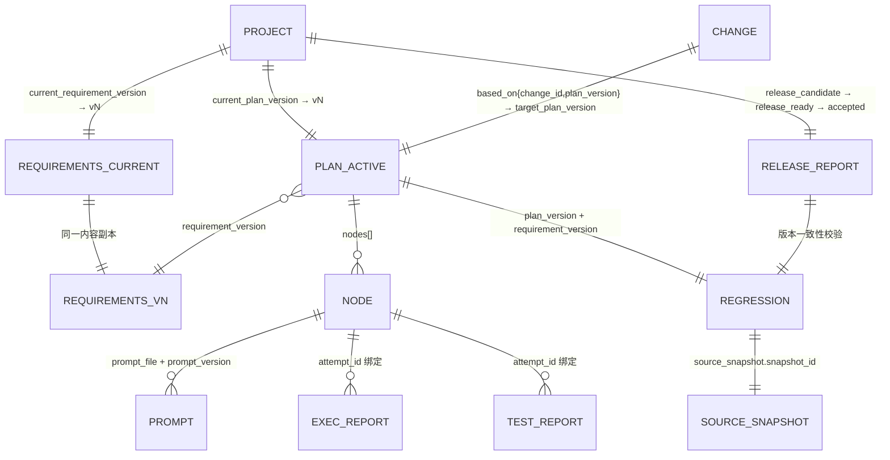

# 02 · 数据模型

> 所有字段名以 `schemas/*.schema.json` 为准；"写入者"以 `scripts/*.py` 实际写盘为准。

## 一、文件清单与定位

| 数据 | 路径 | 定位 | 唯一事实来源 | 写入者 | 是否版本化 |
| --- | --- | --- | --- | --- | --- |
| 项目档案 | `.devflow/project.json` | **正式数据** | 自身 | `df.py`（init/project-set/migrate/release-\*/change-apply） | 否（单文件，`updated_at`） |
| 需求追踪（当前） | `.devflow/requirements/traceability.json` | 正式数据（指针副本） | `traceability-vN.json` | `req-import` | 指针，无版本号字段校验 |
| 需求追踪（历史） | `.devflow/requirements/traceability-vN.json` | **正式数据** | 自身 | `req-import` | 是（按版本号） |
| 需求基准文档 | `.devflow/requirements/confirmed-requirements-vN.md` | **正式数据** | 自身 | **主控/Agent 直接写**（CLI 不写） | 是（文件名） |
| 澄清记录 | `.devflow/requirements/clarification.md` | 过程记录 | 自身 | 主控 | 否 |
| 计划（各版本） | `.devflow/plans/backlog-vN.json` | **正式数据** | 自身 | `plan-import` / `plan-activate` / `start` / `sync` / `accept` / `change-apply` | 是 |
| 看板 | `.devflow/plans/board-vN.md` | **派生** | `backlog-vN.json` | `render_board`（`refresh`） | 跟随计划版本 |
| 依赖图 | `.devflow/plans/dependency-graph-vN.md` | **派生** | `backlog-vN.json` | `dependency_check --write` | 跟随计划版本 |
| 变更申请 | `.devflow/changes/CR-xxx/change-request.json` | **正式数据** | 自身 | `change-new/set/apply` | 目录即版本 |
| 变更说明/影响评估 | `changes/CR-xxx/{change-request.md, impact-assessment.md}` | 人读报告 | JSON 为准 | 主控/Agent | 否 |
| 提示词 | `.devflow/nodes/<ID>/prompt.md` | 正式输入 | 自身 + 版本元数据 | `prompt-init` | 是（`history/` + `prompt_version`） |
| 执行报告 | `.devflow/nodes/<ID>/execution-report.md` | **证据** | 内含 `devflow-execution` JSON | **执行 Agent 直接写** | 返工时归档 `history/` |
| 测试报告 | `.devflow/nodes/<ID>/test-report.json` | **证据** | 自身 | **执行 Agent 直接写** | 同上 |
| 回归报告（机器） | `.devflow/regression/final-report.json` | **正式数据** | 自身 | `regression-import` | 导入前归档 `regression/history/` |
| 回归报告（人读） | `regression/final-report.md` | 派生 | `final-report.json` | `regression-import` 渲染 | 同上 |
| 偏回归前置检查 | `regression/precheck.md` | 过程记录 | — | `regression-check` | 否 |
| 回归代码快照 | `regression/source-snapshot.json` | 证据 | 自身 | `regression-check` | 否（每次覆盖） |
| 交付报告 | `releases/release-report.md` | **报告** | 由计划/证据/回归汇总 | `release` | 覆盖前复制到 `releases/history/` |
| 交付报告元信息 | `releases/release-report.json` | 证据（版本/章节/门槛） | 自身 | `release` | **否（无归档）** |
| 事务日志 | `.devflow/.txn/<id>/journal.json` + `files/` | 恢复用 | 自身 | `Transaction` | 保留最近 20 个（`prune_transactions`） |
| 写锁 | `.devflow/.lock` | 运行时 | — | `ProjectLock` | 不删 |
| 决策记录 | `.devflow/decisions.md` | 过程记录 | 自身 | 主控 | 否 |
| 会话记录 | `.devflow/sessions/` | 过程记录 | — | （目录已建，代码中未见写入点） | — |

> `sessions/` 在 `Paths` 中定义并被 `init` 创建（`dfcore.py:555`、`df.py:253`），但全仓库没有写入它的代码 ——
> **文档/结构声明，代码未证实其用途**。

## 二、关系图

## 三、版本号如何关联

| 版本 | 存放 | 谁引用 | 一致性校验位置 |
| --- | --- | --- | --- |
| `plan_version` | 计划文件名 + `backlog.plan_version` | 节点报告、回归报告、交付报告、CR、project | `validate.py:270`（文件名=内容）；`_binding_problems`（`dfcore.py:1818`）；`_regression_data_problems`（`df.py:2091`）；`release_report_problems`（`df.py:2484`） |
| `requirement_version` | 追踪表 + 计划 + project | 计划、报告、CR、回归、交付 | 计划→追踪表存在性（`df.py:598`）；报告比对（`dfcore.py:1837`）；**project ↔ 追踪表内容版本未比对** |
| `prompt_version` | 节点 + 提示词头 | `start` | `prompt_binding_problems`（`dfcore.py:1258`）五项比对 |
| `attempt_id` | 节点 + 两份报告 | `sync`/`accept` | `_binding_problems`（`dfcore.py:1818`） |
| `snapshot_id` | 回归报告 + `source-snapshot.json` | 交付 | `snapshot_problems`（`df.py:1844`） |
| CR `change_id` | 目录 + JSON + 计划 `based_on` | `change-apply` | `df.py:1665-1685` |

## 四、必须原子一致的数据组

| 组 | 文件 | 现状 |
| --- | --- | --- |
| G1 计划生效 | `backlog-vNew.json`(active) + `backlog-vOld.json`(superseded) + `project.current_plan_version` + `board-vNew.md` | ✅ 走 `Transaction`（`df.py:1706-1714`） |
| G2 需求导入 | `traceability-vN.json` + `traceability.json` | ❌ 两次 `atomic_write_json`，无事务（`df.py:423-426`）；第二次失败则指针与版本文件不一致 |
| G3 节点验收 | `backlog-vN.json`(node.completed) + `board-vN.md` + node.deliverables | ❌ 失败路径用 `save_plan` 不重渲染看板（`df.py:1366`）；成功路径 `refresh` 才渲染 |
| G4 交付候选 | `release-report.md` + `release-report.json` + `project.status=release_candidate` | ❌ 三次写，非事务（`df.py:2419-2437`） |
| G5 回归导入 | `final-report.json` + `final-report.md` + `project.status` | ❌ 非事务（`df.py:1866-1898` 区间） |
| G6 节点开工 | `backlog`(in_progress/attempt_id) + `board` | ✅ `refresh` 内先存计划再渲染（`df.py:152-158`） |

## 五、失效关系（谁变了，谁必须失效）

| 变化 | 应失效 | 代码是否实现 |
| --- | --- | --- |
| 源代码变化 | 回归结论、交付报告 | ✅ `snapshot_problems`（`df.py:1844`，仅比对回归报告记录的快照） |
| 计划内容/版本变化 | 旧提示词、旧回归、旧交付报告 | 部分：提示词 ✅（`prompt_binding_problems`）；回归 ✅（版本比对）；交付报告 ✅（`release_report_problems` 比对版本） |
| 需求内容变化（同版本） | 回归、交付、节点证据 | ❌ 无内容指纹，只在版本号变化时失效（见 INV-019） |
| 节点验收后交付物被改 | 下游 `start` 需重新评估 | ✅ `context_changes`（`dfcore.py:1106`） |
| 契约文件被改 | 下游 `start` 需重新评估 | ✅ 同上（`deliverables.contracts`） |
| 看板被手改 | 无 | ❌ 无哈希校验，只能靠重渲染覆盖 |

## 六、多份副本 / 一致性风险（实测结论）

### R1 `traceability.json` 与 `traceability-vN.json` 是同一事实的两份副本

- 写入点：`df.py:423-426` 先写版本文件再写指针文件。
- 无一致性校验：`validate.py:290-300` 只校验 schema 与"文件存在"，不比对内容或 `requirement_version` 与
  `project.current_requirement_version`。
- 后果：手工改 `traceability.json`（或中断在两次写之间）后，`regression-check`/`release` 都读指针文件，
  历史版本文件与当前事实可能不一致，且无人发现。**P1**

### R2 需求基准文档没有内容指纹

- `req-confirm` 只检查文件存在 + 文本长度 ≥ 200 + 三个关键词（`df.py:435-448`）。
- 之后任何人都可以改 `confirmed-requirements-v1.md` 内容而版本号不变；回归报告只绑定
  `requirement_version=1`，不会失效。
- **这直接违反"正式需求基准只能通过变更流程修改"的设计目标**（见 INV-002 / INV-019）。**P0**

### R3 `req-import` 同版本重复导入会静默覆盖历史

- `plan-import` 有 `--force` + `.history/` 归档（`df.py:501-509`）。
- `req-import` 无守卫、无归档，`--version 1` 再导一次即覆盖 `traceability-v1.json`（`df.py:423`）。
- **P1**（历史可被静默覆盖）

### R4 `release-report.json` 没有历史归档

- `release-report.md` 覆盖前复制到 `releases/history/`（`df.py:2409-2416`）。
- 元信息 JSON 直接覆盖（`df.py:2433`）。
- 影响有限（md 有历史），但"版本一致性证据"只剩最新一份。**P2**

### R5 示例项目与当前交付门禁不自洽

- `examples/sample-project/.devflow/project.json`：`schema_version=1.1`、`status=accepted`。
- 但目录中**没有** `regression/final-report.json`、没有 `releases/release-report.json`、
  也没有 `legacy_regression_accepted` / `legacy_release_shortcut` 标记。
- 用当前代码对同一状态执行 `release-ready` 会因缺机器可读回归报告而失败（`df.py:2067-2089`）。
- 即：**仓库的"标准示例"无法用当前代码复现**，示例测试也只跑 `validate` 与业务逻辑（
  `examples/sample-project/tests/*` 不涉及交付门禁）。**P1**（示例可信度）

### R6 看板与计划可能短期不一致

- `accept` 在拒绝路径先 `project.save_plan(plan)`（`df.py:1366`）但不渲染看板；看板内容仍是上一次 `refresh` 的结果。
- 因为状态未变（仍是 `needs_review`），看板语义上不错误；但 `scope_violations` 等字段不会出现在看板上，
  用户从看板看不出"验收被拦了"。**P2**

## 七、数据模型层面的结论

1. 事实来源划分总体清晰：状态在 JSON、展示在 Markdown、证据在节点目录。
2. 但存在 **两类"第二事实来源"**：`traceability.json` 与需求基准 Markdown，二者都缺少防漂移机制。
3. 所有"版本一致性"校验都基于**版本号**，没有基于**内容指纹**；因此"同版本改内容"是系统性盲区。
4. 原子性只覆盖计划生效（G1），其余多文件写入（G2/G4/G5）依赖"两次原子写"，中断后会留下不一致。
