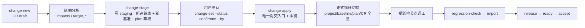
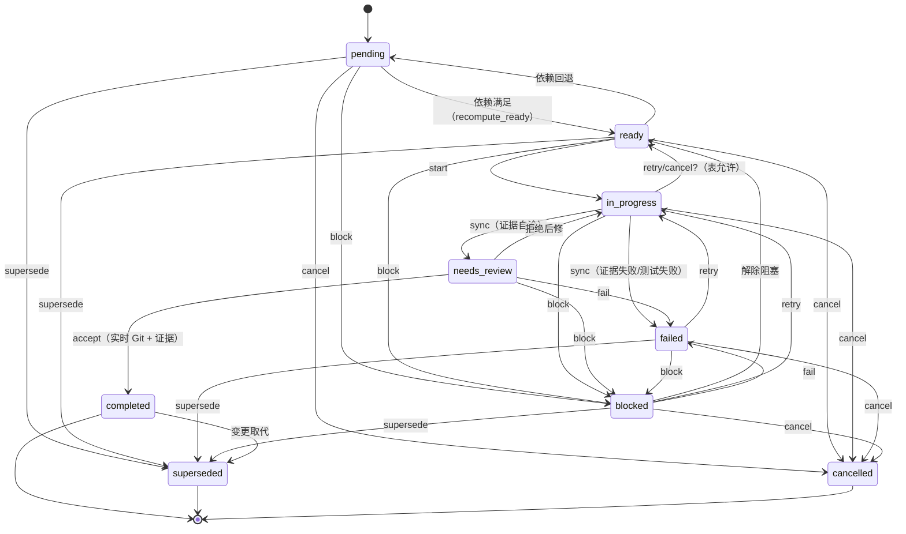
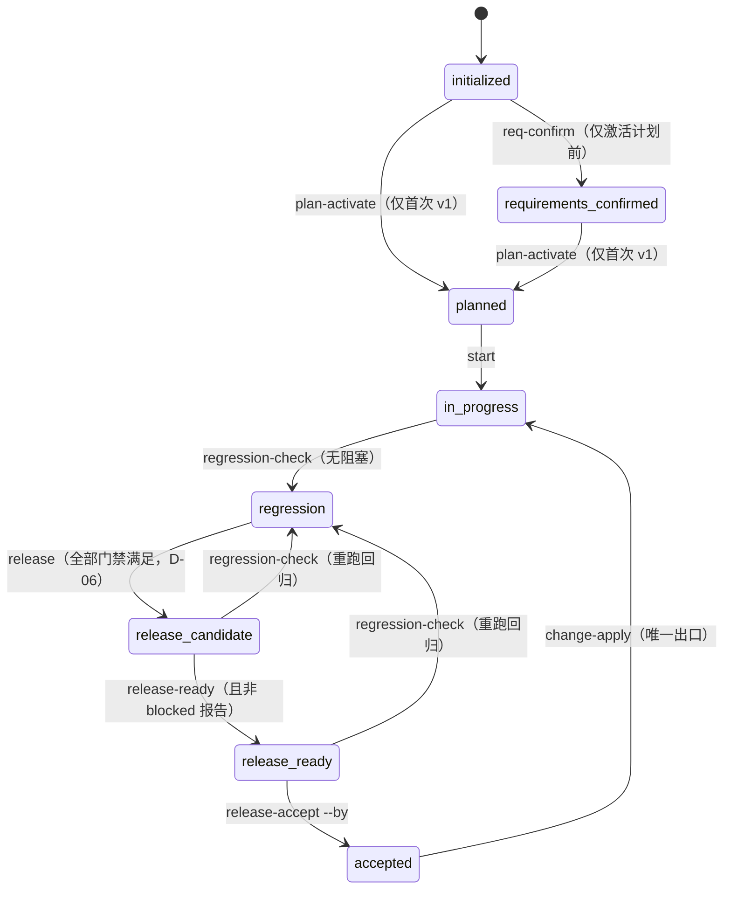
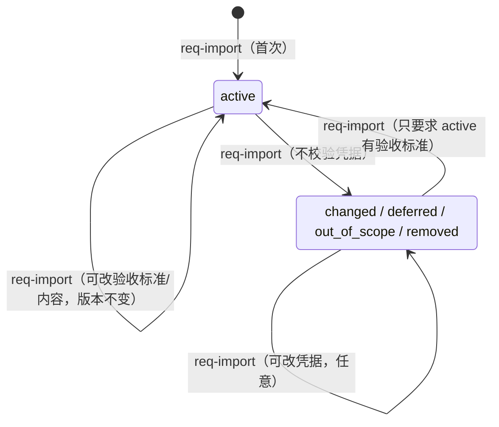
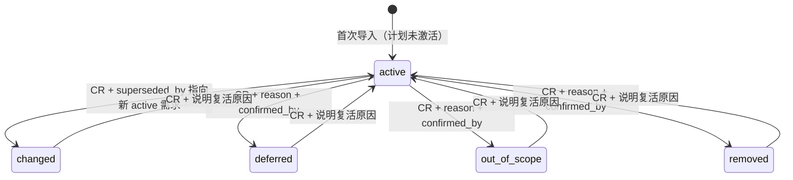
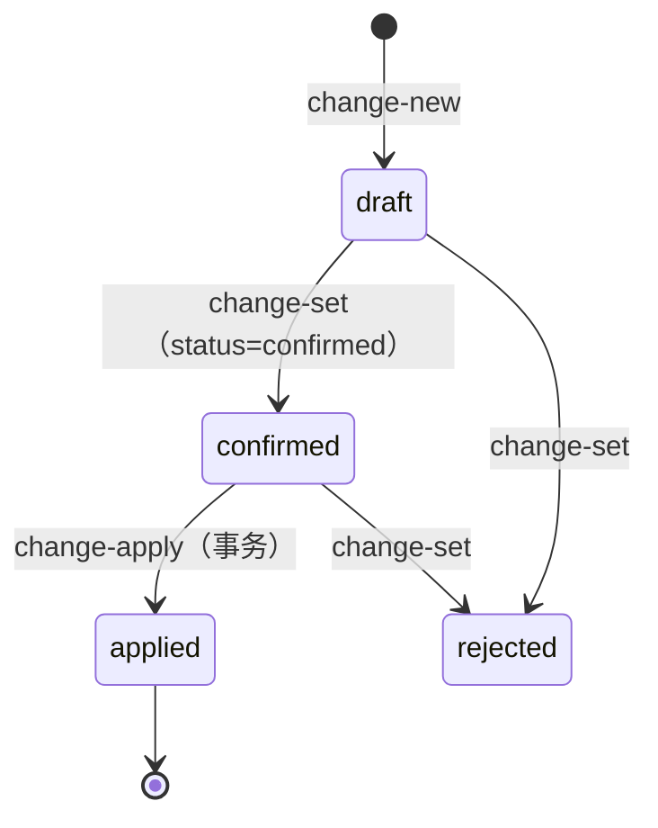
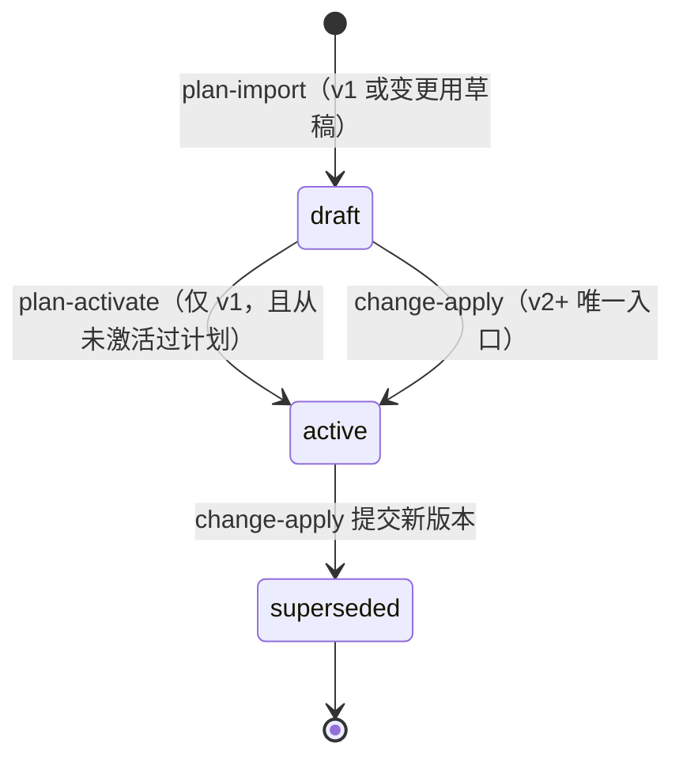
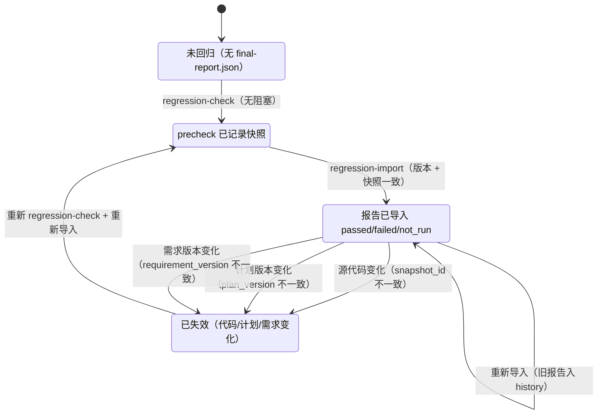
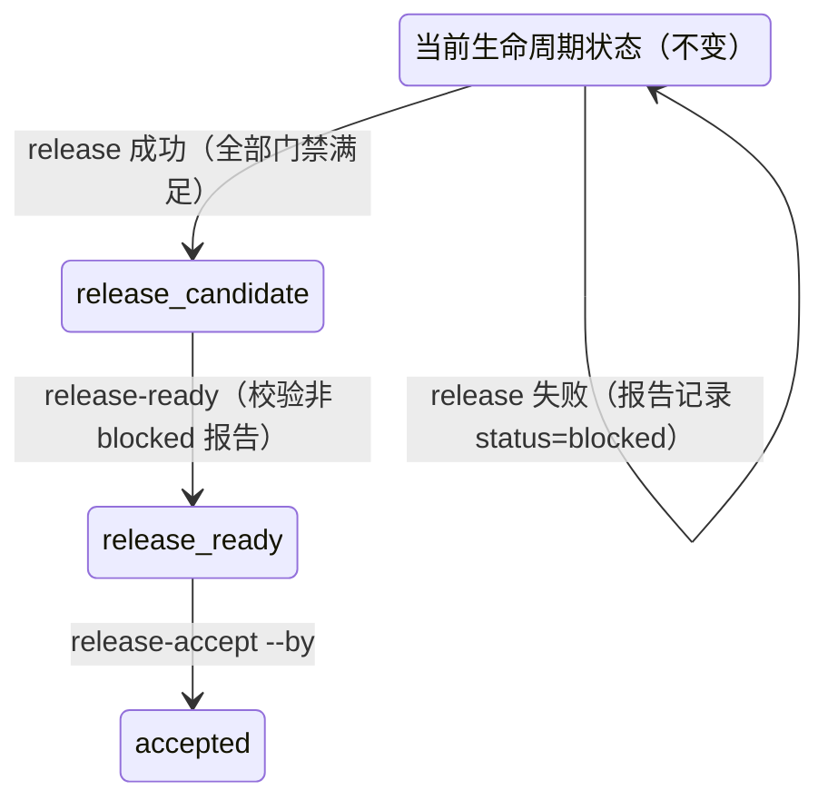

# 03 · 生命周期与状态机

> 状态常量：`dfcore.py:29-75`；节点迁移函数：`df.py transition()`；
> 项目迁移表：`dfcore.py PROJECT_TRANSITIONS` + `df.py transition_project()`（第 1 批已实现）。
> Requirement / Plan / CR / Regression / Release 的细粒度迁移仍由各命令校验。

## 一、端到端生命周期（正常路径）

```mermaid
flowchart LR
  A[init<br/>initialized] --> B[req-import<br/>需求追踪 vN]
  B --> C[req-confirm<br/>requirements_confirmed]
  C --> D[plan-import<br/>draft 计划 + 看板]
  D --> E[plan-activate<br/>planned / active]
  E --> F[start<br/>in_progress + attempt_id]
  F --> G[sync<br/>needs_review / failed]
  G --> H[accept<br/>completed]
  H -->|还有节点| F
  H -->|全部完成| I[regression-check<br/>regression]
  I --> J[regression-import<br/>final-report.json]
  J --> K[release<br/>release_candidate]
  K --> L[release-ready<br/>release_ready]
  L --> M[release-accept --by<br/>accepted]
```

| 阶段 | 前置条件 | 允许命令 | 可改数据 | 必须留下的证据 | 失败恢复 |
| --- | --- | --- | --- | --- | --- |
| init | 目录可写 | `init` | 目录、`project.json` | `project.json` 本身 | 删 `.devflow` 重来；`--force` 幂等（但见 D-04） |
| 需求导入 | **仅首次确认之前**、计划未激活 | `req-import` | `traceability*.json` | 版本化追踪表 | 首次可重导；确认后只能暂存（目标，见 08 D-02） |
| 需求确认 | 追踪表 + 基准文档 | `req-confirm` | `project.json` | 基准 md + 追踪表 | 重新确认 |
| 拆任务 | 需求已确认 | `plan-import`、`prompt-init`、`validate`、`graph` | `backlog-vN.json`、prompt、board、graph | 草稿计划 | 重新导入（`--force` 归档旧文件） |
| 激活 | 草稿 + 校验 0 错误 + 需求文档存在 | `plan-activate` | 计划状态、`project.json` | `approved_by/at` | 无事务；中断可能"无 active 计划"（见 D-06） |
| 执行 | 节点 ready/依赖完成/提示词版本对 | `start` | 节点状态、`attempt_id`、baseline | `attempt_id`、Git baseline | `retry`（归档旧报告） |
| 同步 | 节点 in_progress + 两份报告 | `sync` | 节点状态、`scope_violations`、`git_*` | 两份报告 + 证据块 | `retry` / `fail` |
| 验收 | 节点 needs_review + 证据齐全 + 实时 Git 核对 | `accept` | 节点 completed、`deliverables`、豁免记录 | 交付物指纹、waiver | 保留 `needs_review` 修复后重来 |
| 回归前置 | 无 open 节点、证据齐全、需求覆盖 | `regression-check` | `project.json`（regression）、快照 | `precheck.md`、`source-snapshot.json` | 修节点后重跑 |
| 回归导入 | 报告与计划/需求版本一致 + 快照一致 | `regression-import` | `final-report.{json,md}` | 机器可读报告 | 重新导入（旧报告进 `history/`） |
| 交付报告 | 回归 passed + 节点全完成 + 需求覆盖 | `release` | `release-report.{md,json}`、状态 | 报告 + 元信息 | 重跑 `release`（md 归档） |
| 待验收 | 状态 `release_candidate` + 报告完整 + 快照一致 | `release-ready` | `project.json` | `release_ready_at` | 修复后重跑 |
| 验收 | 状态 `release_ready` | `release-accept` | `project.json`（accepted） | `accepted_by/at` | 终态；继续开发走 CR |

## 二、需求变更流程（目标：CR 暂存 + 原子提交）

**数据流（staging 不碰正式文件）**：

| 阶段 | 写入位置 | 正式数据是否变化 | 谁负责 |
| --- | --- | --- | --- |
| 提议 | `changes/CR-xxx/staging/**` + `manifest.json` | ❌ 不变 | 主控 |
| 确认 | CR `requirement_change` + `staging_manifest_sha256` | ❌ 不变 | **用户**（`--by`） |
| 提交 | 见 08 D-02 §5 的「需求变更原子提交文件集合」（数量由 CR 动态决定） | ✅ 事务内全量切换；并发读者被读写互斥挡在门外、OPEN 残留时拒绝（§5b） | 主控执行 `change-apply` |

**提交前置（必须全部满足）**：
- CR `confirmed`；`base_plan_version` / `base_requirement_version` == 当前指针；
- 目标计划 `draft`、`based_on` 指向本 CR、版本号 == `CR.target_plan_version`；
- 需求变更时：staging 的 `requirement_version == current + 1`，双 digest 与 manifest 一致，
  `plan.requirement_version == 新版本`，`plan.requirement_baseline_id == staging.baseline_id`；
- `migration_problems` 为空、`validate(activating=True)` 0 错误。

**失败恢复**：
- 校验失败：不写任何文件，staging 保留，CR 仍 `confirmed`；
- 写入中失败：`Transaction` 按 `existed_before` 回滚文件集合（原本不存在则删除；含指针与 project），CR 回 `confirmed`；
- 进程崩溃：journal 停在 open，`recover --apply` 回滚；`doctor` 报告未完成事务。

**正式指针切换点**：只在 `change-apply` 的第 7 步（`traceability.json`），且与 project/plan 更新在同一事务。
切换成功后，旧回归与旧交付报告因 `baseline_id` 不匹配而失效。

> 现状：没有 staging，`req-import` 直接覆盖正式表；`change-apply` 只切计划，不处理需求文件。
> 因此本节的 staging 与「需求变更原子提交文件集合」都是**待实现**。

## 三、七个状态模型（合法迁移 / 触发命令 / 前置条件 / 证据）

> 说明：**只有 Node 有显式迁移表**（`dfcore.py:61`）。Project / Requirement / Plan / CR /
> Regression / Release 都没有统一迁移函数，状态由具体命令直接赋值。下表中
> "迁移合法性"列写的是**代码实际行为**；"应有"列在 `07-target-architecture.md` 里给目标。

### 3.1 Node（唯一有迁移表的状态机）

| 迁移 | 触发命令 | 前置条件 | 证据 |
| --- | --- | --- | --- |
| pending→ready | 任意状态变更后的 `recompute_ready` | 依赖全部 completed | 计划 JSON |
| ready→in_progress | `start` | 计划 active、提示词版本匹配、上下文未变或已 acks | `attempt_id`、`git_baseline`、`scope_baseline` |
| in_progress→needs_review | `sync` | 两份报告齐全 + 证据自洽 + 范围检查 | 节点报告、`scope_violations`/`git_*` |
| in_progress→failed | `sync`（失败）/ `fail` | — | 报告、`blocked_reason` |
| needs_review→completed | `accept` | 实时 Git 复算通过 + 证据 + 豁免留痕 | `deliverables`（含契约指纹）、`scope_waivers`/`git_waivers` |
| *→superseded | `supersede` / 新计划迁移 | 目标节点存在 | `superseded_by` |
| *→cancelled | `cancel` | 给出原因 | `blocked_reason`/remark |

**禁止迁移**：一切不在 `TRANSITIONS` 中的组合（如 `completed→in_progress`、`cancelled→*`）。

### 3.2 Project（已实现迁移表 + D-01/D-06 收口）

**已强制执行的约束（`PROJECT_TRANSITIONS` + `transition_project()`）**：

- **普通推进**：`initialized/requirements_confirmed → planned`（`plan-activate` 仅允许首次 v1）、`planned → in_progress`（`start`）、`planned/in_progress → regression`（`regression-check` 无阻塞）、`regression/release_candidate/release_ready → release_candidate`（`release` **全部门禁满足**时才置位；有 blockers 则保持原状态并写 `status="blocked"`）、`release_candidate → release_ready`（`release-ready`，并校验报告非 `blocked`）、`release_ready → accepted`（`release-accept --by`）。
- **受控重跑回归**：`release_candidate / release_ready → regression`（`regression-check` 无阻塞时允许重新进入回归阶段，随后需重新 `release` → `release-ready`）。
- **`change-apply` 受控退出/重开**：`accepted` 及各活跃阶段均可通过 `change-apply`（经 CR 确认 + `based_on` 绑定 + 事务）迁移到 `in_progress` 或 `planned`；`req-confirm` 在 `planned` 及之后阶段或已有 `active` 计划时一律拒绝回退。

### 3.3 Requirement（Schema / 当前 CLI / 目标 三层）

**必须先分清三层，不能把目标要求当成现状。**

| 层 | 允许什么 | 校验什么 | 代码 |
| --- | --- | --- | --- |
| Schema | `status ∈ {active, changed, removed, deferred, out_of_scope}`；`reason`/`confirmed_by`/`superseded_by` 都是**可选** | 类型/枚举 | `schemas/requirements.schema.json` |
| **当前 CLI** | `req-import` 仅在首次确认与计划激活前允许整表导入（`initialized`/`analyzing`/`clarifying`）；同版本重复导入归档旧表 | 校验 `active` 的 `acceptance` 与非 `active` 的退役凭据（`reason`+`confirmed_by`/`superseded_by`）；`req-confirm` 写入 `project.requirement_baseline` 双摘要；`delivery_blockers` 重校验退役凭据、文件完整性与双摘要 | `df.py cmd_req_import` / `cmd_req_confirm` / `delivery_blockers`、`dfcore.py` |
| 目标（D-02 剩余） | `active↔retired` 通过 `change-stage` 暂存 + `change-apply` 原子切换 + `baselines.json` 追加账本 | staging、`baselines.json`、`regression-import` 绑 `baseline_id` | 第 2 批待实现 |

> 当前说明：`req-import` 已不再允许在 `planned` 及之后阶段或已确认需求后覆写正式表，且会在导入期检查退役凭据；但 `change-stage` 暂存与 `baselines.json` 账本仍待第 2 批实现。

**当前实际能力**（代码事实）：

**目标合法迁移**（待实现）：

| 要点 | 事实 |
| --- | --- |
| 迁移入口 | 当前只有 `req-import` 整表替换；目标新增 `change-stage`（暂存）与 `change-apply`（正式切换） |
| 合法性检查点 | 当前：`req-import`、`req-confirm`、`validate`、`regression-check` 与 `delivery_blockers`（`release`/`release-ready`/`release-accept`）均已校验 |
| 凭据 | `reason` + `confirmed_by`（退役）、`superseded_by`（changed）、`requirement_version` 递增 |
| 目标禁止 | 无凭据退役、跳版/回退、在计划激活后直接改正式表、复活不留原因 |

**哪些需求变更必须经 CR + 用户确认**（目标，按 D-01/D-02）：

| 变更 | 是否需要 CR | 是否需要用户确认 | 当前实现 |
| --- | --- | --- | --- |
| active → removed / deferred / out_of_scope / changed | 是 | 是 | ❌ 仅 `req-import`，无凭据校验 |
| 修改 active 需求的验收标准 / 业务规则 | 是（新版本） | 是 | ❌ 直接改文档或重新导入 |
| 新增需求 / 调整优先级 | 是（新版本） | 是 | ❌ 同上 |
| 非 active → active（复活） | 是 | 是 | ❌ 只要求有验收标准 |
| 只改描述性文字、不影响判定 | 否（但需审计） | 否 | ❌ 无审计 |

### 3.4 CR

| 迁移 | 触发 | 前置 | 证据 |
| --- | --- | --- | --- |
| draft→confirmed | `change-set` | schema + 用户确认 | `confirmed_at/by` |
| confirmed→applied | `change-apply` | 基准匹配、目标计划 driven by CR、迁移合法、validate 通过 | `applied_at`，事务 journal |
| →rejected | `change-set` | 无强制原因 | **无 reason 要求（P2）** |

### 3.5 Plan（已实现 D-01）

| 迁移 | 触发 | 前置（当前已实现） | 说明 |
| --- | --- | --- | --- |
| draft→active | `plan-activate` | 仅 `plan_version == 1`、`current_plan_version is None`、无其他 active 计划、项目处于初始化/需求确认阶段、validate 通过 | v2+ 一律拒绝并指向 `change-apply`（D-01 已实现） |
| draft→active | `change-apply` | CR 严格绑定 + 基准 + 迁移 + validate + 事务 | v2+ 唯一合法通道 |

- 注：`plan.status=active` 的统一收口重构（`dfstate` 模块，D-10）仍待定。

### 3.6 Regression（报告级 + 项目级）

| 要点 | 事实 |
| --- | --- |
| 报告状态 | `passed` / `failed` / `not_run`，由必需项推导（`df.py:2018`） |
| 失效判定 | 代码：`snapshot_problems`（`df.py:1844`）比对 `source_snapshot`；计划/需求：导入与交付时比对版本号（`df.py:2091`） |
| 未绑定的 | **需求内容 digest**（只绑版本号）；**需求退役状态** |
| 项目状态 | `regression-check` 通过后置 `regression`（`df.py:2006`）；导入报告本身不改项目状态 |

### 3.7 Release（已实现 D-06）

| 迁移 | 触发 | 前置 | 证据 |
| --- | --- | --- | --- |
| regression/release_*→candidate | `release` | 全部门禁（节点/证据/回归/快照/需求基线/退役凭据） | `release-report.{md,json}`、`release_candidate_at` |
| candidate→ready | `release-ready` | 状态 + 门禁重跑 + 报告完整且 `meta.status == release_candidate`、`blockers == []` | `release_ready_at` |
| ready→accepted | `release-accept --by` | 状态 + 门禁重跑 + 验收人 | `accepted_at/by` |

> D-06 已落地：报告是否存在/有 blockers 写在 `release-report.json.status`（`blocked` / `release_candidate`）与 `blockers[]`；门禁失败时 `project.status` 保持原状态不变，且 `release-ready` 拒绝使用 `blocked` 报告。

## 四、可绕过正常命令改状态的路径（代码证据）

| # | 路径 | 证据 | 严重度 |
| --- | --- | --- | --- |
| B1 | 手工编辑 `backlog-vN.json` 改节点状态，CLI 无哈希可发现 | 无任何完整性校验；`load_json` 直接读（`dfcore.py:107`） | P0（设计前提是"只有 CLI 写"，但无机制保证） |
| B2 | `plan-import` v2 无 `based_on` + `plan-activate` → 绕过 CR 直接换计划 | 已缓解（D-01：`cmd_plan_activate` 拒绝 v2+ 并指向 `change-apply`） | **已修复** |
| B3 | `plan-activate` 从 `regression`/`release_candidate` 回退到 `planned` | 已缓解（`PROJECT_TRANSITIONS` + `cmd_plan_activate` 状态守卫） | **已修复** |
| B4 | `release` 从任意状态跳 `release_candidate` | 已缓解（D-06：`blockers` 非空不改状态，`transition_project` 限制来源为 `regression`/`release_*`） | **已修复** |
| B5 | `init --force` 在已有项目上不落盘 | 已修复（修改 `project_type`/`quality_profile` 后保存，并拒绝覆盖 `accepted`） | **已修复** |
| B6 | `doctor` 写依赖图但不在 MUTATING 集合 | `df.py` 调 `_run_dependency_check(...,--write)`；`MUTATING_COMMANDS` 不含 `doctor` | P2（第 2 批待处理） |
| B7 | `req-import` 覆盖同版本历史 | 已缓解（覆写前归档到 `requirements/history/`） | **已修复** |
| B8 | 手工改 `confirmed-requirements-vN.md`，版本号不变 | `req-confirm` 写入 `project.requirement_baseline` 双摘要，`delivery_blockers` 重算校验（旧项目无 baseline 时 fail-closed，需 `migrate --adopt-baseline`）；恶意 Agent 同改文件与摘要仍需外部审批边界（04 §5.5） | **已缓解（防误操作）** |
| B9 | `release_ready` 后 `req-import` 把 active 需求改成 `removed` 缩小交付范围 | 已被 `cmd_req_import` 阶段守卫 + `delivery_blockers` 退役凭据与双摘要/一致性校验拦截；直接改文件仍受摘要校验保护 | **已修复（CLI 路径）** |
| B10 | `planned` 状态执行 `req-confirm` 回退状态并改版本指针 | 已被 `cmd_req_confirm` 状态守卫与 `PROJECT_TRANSITIONS` 拦截 | **已修复** |

## 五、阶段跳转矩阵（当前实现，已收口）

| 从 \ 到 | requirements_confirmed | planned | in_progress | regression | release_candidate | release_ready | accepted |
| --- | --- | --- | --- | --- | --- | --- | --- |
| initialized | req-confirm | plan-activate（仅 v1） | change-apply（base=0） | ✗ | ✗ | ✗ | ✗ |
| requirements_confirmed | req-confirm | plan-activate（仅 v1） | change-apply（base=0） | ✗ | ✗ | ✗ | ✗ |
| planned | ✗ | change-apply | start / change-apply | regression-check（无阻塞） | ✗ | ✗ | ✗ |
| in_progress | ✗ | change-apply | start / change-apply | regression-check（无阻塞） | ✗ | ✗ | ✗ |
| regression | ✗ | change-apply | change-apply | regression-check | release（无阻塞） | release-ready（仅 legacy） | ✗ |
| release_candidate | ✗ | change-apply | change-apply | regression-check | release（无阻塞） | release-ready | ✗ |
| release_ready | ✗ | change-apply | change-apply | regression-check | release（无阻塞） | ✗ | release-accept --by |
| accepted | ✗（白名单） | change-apply | change-apply | ✗ | ✗ | ✗ | ✗ |

## 六、状态机层面的结论

1. **Node 与 Project 均已有显式迁移表**：`TRANSITIONS`（节点）与 `PROJECT_TRANSITIONS`（项目）分别通过 `transition()` 与 `transition_project()` 收口全部写入点；Plan / Requirement / Release 的部分规则仍由各命令校验。
2. 原 B2 / B3 / B4 / B5 / B7 / B9 / B10 绕过已在第 1 批代码改造中关闭；剩余 B1（`backlog-vN.json` 无独立签名/哈希）与恶意 Agent 直接改仓库文件问题属于第 4 轮身份与隔离边界（D-02 §3 / D-03）。
3. **待推进的第 2 批**：`change-stage`（CR staging）、`baselines.json` 追加账本、`regression-import` 绑定 `baseline_id`、读写互斥 + OPEN 崩溃标记、`init` 首次锁与 `doctor` 加锁。
