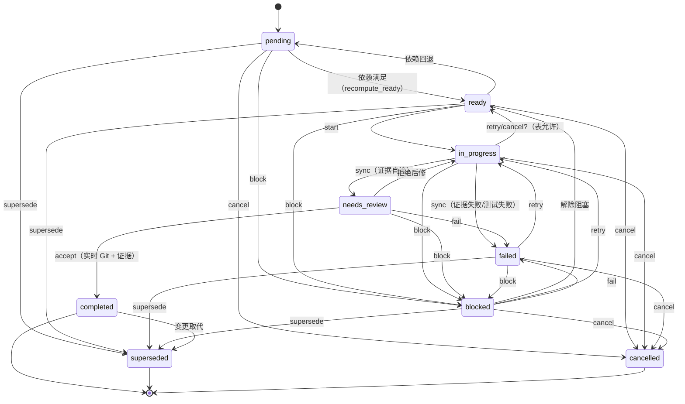
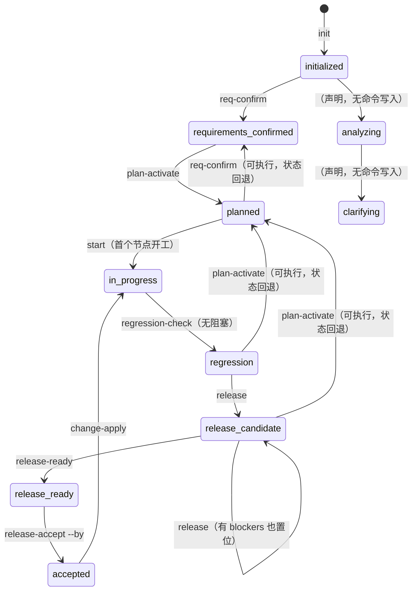
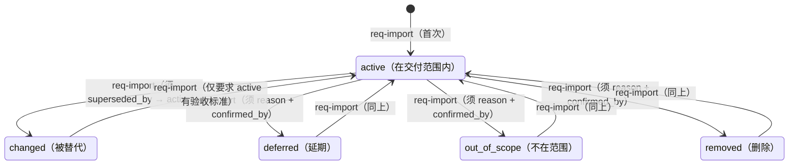
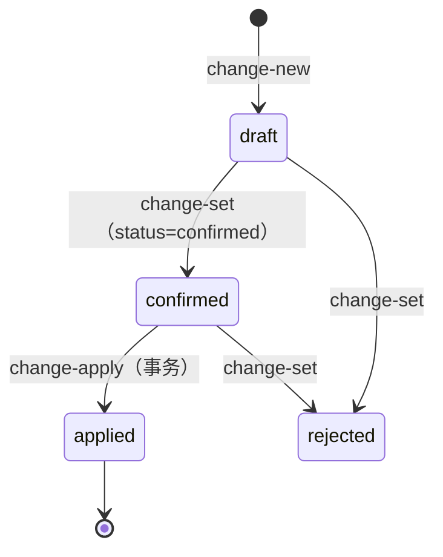
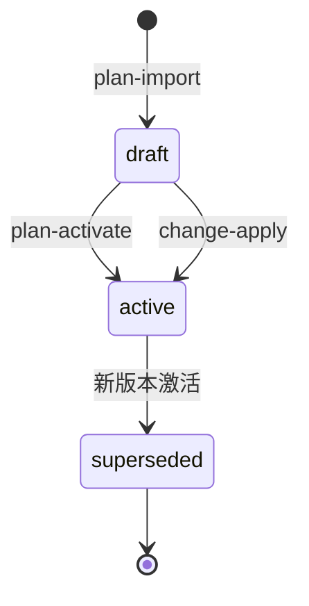
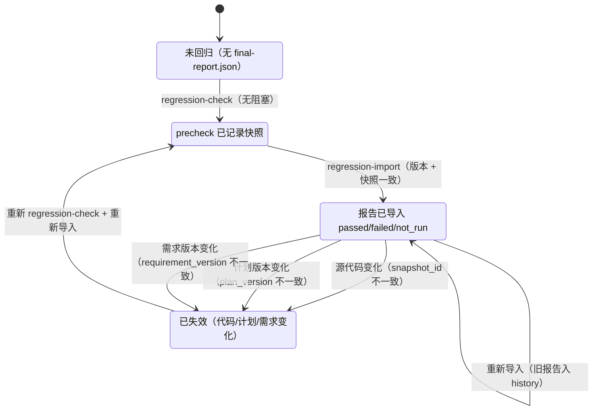
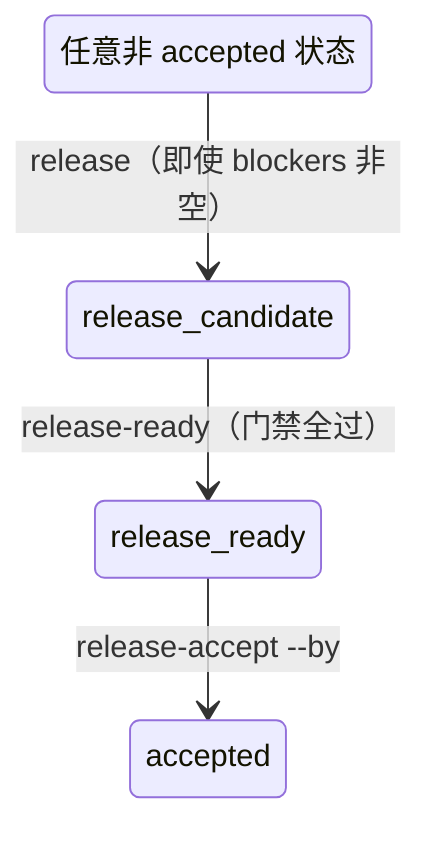
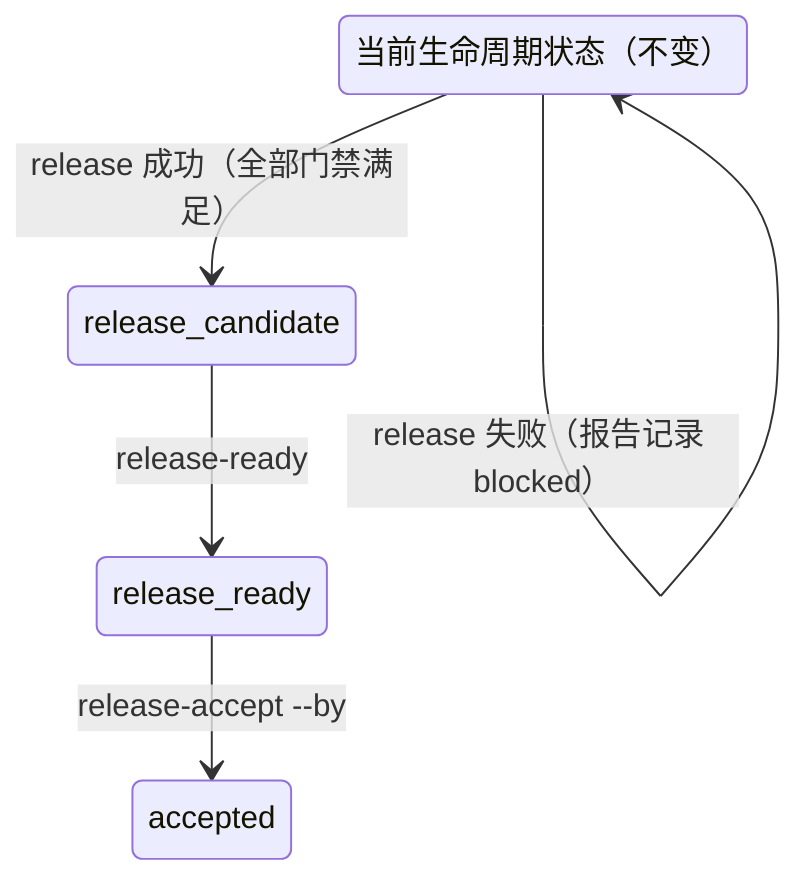

# 03 · 生命周期与状态机

> 状态常量：`dfcore.py:29-75`；迁移函数：`df.py:159 transition()`（节点）；
> 项目状态**没有**统一迁移表，由各命令直接赋值（证据见第五节）。

## 一、端到端生命周期（正常路径）

```mermaid
flowchart LR
  A[init<br/>initialized] --> B[req-import<br/>需求追踪 vN]
  B --> C[req-confirm<br/>requirements_confirmed]
  C --> D[plan-import<br/>draft 计划 + 看板]
  D --> E[plan-activate<br/>planned / active]
  E --> F[start<br/>in_progress + attempt_id]
  F --> G[sync<br/>needs_review / failed]
  G --> H[accept<br/>completed]
  H -->|还有节点| F
  H -->|全部完成| I[regression-check<br/>regression]
  I --> J[regression-import<br/>final-report.json]
  J --> K[release<br/>release_candidate]
  K --> L[release-ready<br/>release_ready]
  L --> M[release-accept --by<br/>accepted]
```



| 阶段 | 前置条件 | 允许命令 | 可改数据 | 必须留下的证据 | 失败恢复 |
| --- | --- | --- | --- | --- | --- |
| init | 目录可写 | `init` | 目录、`project.json` | `project.json` 本身 | 删 `.devflow` 重来；`--force` 幂等（但见 D-04） |
| 需求导入 | `project.json` 存在 | `req-import` | `traceability*.json` | 版本化追踪表 | 重新导入（同版本会覆盖，见 R3） |
| 需求确认 | 追踪表 + 基准文档 | `req-confirm` | `project.json` | 基准 md + 追踪表 | 重新确认 |
| 拆任务 | 需求已确认 | `plan-import`、`prompt-init`、`validate`、`graph` | `backlog-vN.json`、prompt、board、graph | 草稿计划 | 重新导入（`--force` 归档旧文件） |
| 激活 | 草稿 + 校验 0 错误 + 需求文档存在 | `plan-activate` | 计划状态、`project.json` | `approved_by/at` | 无事务；中断可能"无 active 计划"（见 D-06） |
| 执行 | 节点 ready/依赖完成/提示词版本对 | `start` | 节点状态、`attempt_id`、baseline | `attempt_id`、Git baseline | `retry`（归档旧报告） |
| 同步 | 节点 in_progress + 两份报告 | `sync` | 节点状态、`scope_violations`、`git_*` | 两份报告 + 证据块 | `retry` / `fail` |
| 验收 | 节点 needs_review + 证据齐全 + 实时 Git 核对 | `accept` | 节点 completed、`deliverables`、豁免记录 | 交付物指纹、waiver | 保留 `needs_review` 修复后重来 |
| 回归前置 | 无 open 节点、证据齐全、需求覆盖 | `regression-check` | `project.json`（regression）、快照 | `precheck.md`、`source-snapshot.json` | 修节点后重跑 |
| 回归导入 | 报告与计划/需求版本一致 + 快照一致 | `regression-import` | `final-report.{json,md}` | 机器可读报告 | 重新导入（旧报告进 `history/`） |
| 交付报告 | 回归 passed + 节点全完成 + 需求覆盖 | `release` | `release-report.{md,json}`、状态 | 报告 + 元信息 | 重跑 `release`（md 归档） |
| 待验收 | 状态 `release_candidate` + 报告完整 + 快照一致 | `release-ready` | `project.json` | `release_ready_at` | 修复后重跑 |
| 验收 | 状态 `release_ready` | `release-accept` | `project.json`（accepted） | `accepted_by/at` | 终态；继续开发走 CR |

## 二、需求变更流程

```mermaid
flowchart LR
  A[change-new<br/>CR draft] --> B[影响分析<br/>impacts / target_*]
  B --> C[change-set<br/>confirmed]
  C --> D[plan-import vNew<br/>based_on{CR, base}]
  D --> E[prompt-init --plan N]
  E --> F[change-apply<br/>事务提交]
  F --> G[新计划 active<br/>project → in_progress/planned]
  G --> H[执行受影响节点]
  H --> I[regression-check → import]
  I --> J[release → ready → accept]
```

前置条件（`df.py:1623-1700`）：
- CR `status=confirmed`、`target_plan_version` 存在；
- `base_plan_version` / `base_requirement_version` 与当前一致（`base=0` 也参与比较）；
- 目标计划 `status=draft`、`based_on.change_id == CR`、`based_on.plan_version == CR.base_plan_version`；
- 目标计划的需求版本 = CR.target_requirement_version，且需求基准文件存在；
- `migration_problems`（`dfcore.py:1705`）：旧节点不能消失、返工要写 `remark`、新计划不能凭空 completed；
- `validate(activating=True)` 0 错误。

失败恢复：事务 journal 在 `.devflow/.txn/<id>/`，`df.py recover --apply` 回滚（`df.py:2641`）。

## 三、七个状态模型（合法迁移 / 触发命令 / 前置条件 / 证据）

> 说明：**只有 Node 有显式迁移表**（`dfcore.py:61`）。Project / Requirement / Plan / CR /
> Regression / Release 都没有统一迁移函数，状态由具体命令直接赋值。下表中
> "迁移合法性"列写的是**代码实际行为**；"应有"列在 `07-target-architecture.md` 里给目标。

### 3.1 Node（唯一有迁移表的状态机）



| 迁移 | 触发命令 | 前置条件 | 证据 |
| --- | --- | --- | --- |
| pending→ready | 任意状态变更后的 `recompute_ready` | 依赖全部 completed | 计划 JSON |
| ready→in_progress | `start` | 计划 active、提示词版本匹配、上下文未变或已 acks | `attempt_id`、`git_baseline`、`scope_baseline` |
| in_progress→needs_review | `sync` | 两份报告齐全 + 证据自洽 + 范围检查 | 节点报告、`scope_violations`/`git_*` |
| in_progress→failed | `sync`（失败）/ `fail` | — | 报告、`blocked_reason` |
| needs_review→completed | `accept` | 实时 Git 复算通过 + 证据 + 豁免留痕 | `deliverables`（含契约指纹）、`scope_waivers`/`git_waivers` |
| *→superseded | `supersede` / 新计划迁移 | 目标节点存在 | `superseded_by` |
| *→cancelled | `cancel` | 给出原因 | `blocked_reason`/remark |

**禁止迁移**：一切不在 `TRANSITIONS` 中的组合（如 `completed→in_progress`、`cancelled→*`）。

### 3.2 Project



| 迁移 | 触发命令 | 前置条件（实际） | 证据 | 问题 |
| --- | --- | --- | --- | --- |
| initialized→requirements_confirmed | `req-confirm` | 基准文档存在 + 追踪表合格 | 追踪表、基准 md | — |
| planned→requirements_confirmed | `req-confirm` | **不检查 planned** | 同上 | **状态回退 + 版本指针可改**（A7） |
| requirements_confirmed→planned | `plan-activate` | 计划 draft + validate | `approved_by/at` | 无事务 |
| planned/in_progress→planned | `plan-activate`（新版本） | 同上 | — | **可绕过 CR 换计划**（B2） |
| in_progress→regression | `regression-check` | 无 open 节点、证据齐、需求覆盖 | `precheck.md`、`source-snapshot.json` | — |
| regression→release_candidate | `release` | **只拒 accepted** | 报告 md + meta | blockers 非空也置位（D-06） |
| release_candidate→release_ready | `release-ready` | 状态 + 全部门禁 + 报告完整 | `release_ready_at` | — |
| release_ready→accepted | `release-accept --by` | 全部门禁重跑 | `accepted_by/at` | 不重校验需求基准（A6） |
| accepted→in_progress | `change-apply` | CR 完整校验 | 新计划 + CR applied | 唯一合法出口 |

### 3.3 Requirement（**无迁移表，整表替换**）



| 要点 | 事实 |
| --- | --- |
| 迁移入口 | 只有 `req-import` 整表替换（`df.py:399`）；没有逐条状态命令 |
| 合法性检查点 | `validate`（`validate.py:297`）与 `regression-check`（`df.py:1931`）调用 `requirement_retirement_problems`；**`req-import` 不调用**、**交付门禁不调用** |
| CR 关系 | 设计上需求变更必须走 CR；实现上 `req-import` 无状态门槛、无版本单调性检查、无 CR 绑定 |
| 复活（非 active→active） | 唯一约束是"active 必须有非空 acceptance"（`dfcore.py:1898`）；**不要求**说明为什么复活、不要求 CR |
| 证据 | `reason` / `confirmed_by`（退役）、`superseded_by`（changed）、`requirement_version` 递增、新 `confirmed-requirements-vN.md` |
| 禁止（目标） | active→removed 等退役必须带凭据 + 经 CR；不允许无凭据退役后仍通过交付 |

**哪些需求变更必须经 CR + 用户确认**（目标，按 D-01/D-02）：

| 变更 | 是否需要 CR | 是否需要用户确认 | 当前实现 |
| --- | --- | --- | --- |
| active → removed / deferred / out_of_scope / changed | 是 | 是 | ❌ 仅 `req-import`，无凭据校验 |
| 修改 active 需求的验收标准 / 业务规则 | 是（新版本） | 是 | ❌ 直接改文档或重新导入 |
| 新增需求 / 调整优先级 | 是（新版本） | 是 | ❌ 同上 |
| 非 active → active（复活） | 是 | 是 | ❌ 只要求有验收标准 |
| 只改描述性文字、不影响判定 | 否（但需审计） | 否 | ❌ 无审计 |

> 当前 `req-import` 把以上所有情况都当作"整表替换"，既不要求 CR 也不要求用户确认。

### 3.4 CR



| 迁移 | 触发 | 前置 | 证据 |
| --- | --- | --- | --- |
| draft→confirmed | `change-set` | schema + 用户确认 | `confirmed_at/by` |
| confirmed→applied | `change-apply` | 基准匹配、目标计划 driven by CR、迁移合法、validate 通过 | `applied_at`，事务 journal |
| →rejected | `change-set` | 无强制原因 | **无 reason 要求（P2）** |

### 3.5 Plan



| 迁移 | 触发 | 前置（实际） | 问题 |
| --- | --- | --- | --- |
| draft→active | `plan-activate` | 计划自身校验 + 需求基准存在 | **不要求 based_on / 不检查项目状态** |
| draft→active | `change-apply` | CR 严格绑定 + 基准 + 迁移 + 事务 | 唯一受审计的通道 |

### 3.6 Regression（报告级 + 项目级）



| 要点 | 事实 |
| --- | --- |
| 报告状态 | `passed` / `failed` / `not_run`，由必需项推导（`df.py:2018`） |
| 失效判定 | 代码：`snapshot_problems`（`df.py:1844`）比对 `source_snapshot`；计划/需求：导入与交付时比对版本号（`df.py:2091`） |
| 未绑定的 | **需求内容 digest**（只绑版本号）；**需求退役状态** |
| 项目状态 | `regression-check` 通过后置 `regression`（`df.py:2006`）；导入报告本身不改项目状态 |

### 3.7 Release

**当前实现**（含缺陷）：



**目标（D-06，待实施）**：



| 迁移 | 触发 | 前置 | 证据 |
| --- | --- | --- | --- |
| *→candidate（当前） | `release` | 只拒 accepted | `release-report.{md,json}`、`release_candidate_at` |
| *→candidate（目标） | `release` | 全部门禁（节点/证据/回归/快照/需求基线/报告） | 同上 |
| candidate→ready | `release-ready` | 状态 + 门禁重跑 + 报告完整 | `release_ready_at` |
| ready→accepted | `release-accept --by` | 状态 + 门禁重跑 + 验收人 | `accepted_at/by` |

> 当前 `release_candidate` 同时表示"报告已生成"和"具备候选资格"，这两个含义在 D-06 中拆开：
> 报告是否有 blockers 只写进 `release-report.json.blockers`，不再影响状态。

## 四、可绕过正常命令改状态的路径（代码证据）

| # | 路径 | 证据 | 严重度 |
| --- | --- | --- | --- |
| B1 | 手工编辑 `backlog-vN.json` 改节点状态，CLI 无哈希可发现 | 无任何完整性校验；`load_json` 直接读（`dfcore.py:107`） | P0（设计前提是"只有 CLI 写"，但无机制保证） |
| B2 | `plan-import` v2 无 `based_on` + `plan-activate` → 绕过 CR 直接换计划 | `df.py:522`（based_on 可空）；`validate.py:516-523`（仅 when based_on）；`df.py:587`（激活无状态/CR 校验） | **P0** |
| B3 | `plan-activate` 从 `regression`/`release_candidate` 回退到 `planned` | `df.py:587-640` 无状态前置；`df.py:628` 直接赋值 | P1 |
| B4 | `release` 从任意状态跳 `release_candidate` | `df.py:2246` 只拒 accepted；`df.py:2435` 无条件置位 | P1（后续 ready 会拦，但状态已污染） |
| B5 | `init --force` 在已有项目上不落盘（不是绕过，但行为与预期不符） | `df.py:287-297` 只改内存对象，未 `save()` | P2 |
| B6 | `doctor` 写依赖图但不在 MUTATING 集合 | `df.py:3338` 调 `_run_dependency_check(...,--write)`；`df.py:47` 不含 doctor | P2（派生文件，可能并发写冲突） |
| B7 | `req-import` 覆盖同版本历史 | `df.py:423` 无 `--force`/归档 | P1 |
| B8 | 手工改 `confirmed-requirements-vN.md`，版本号不变 | `df.py:435-448` 只检查存在/长度/关键词 | **P0** |
| B9 | `release_ready` 后 `req-import` 把 active 需求改成 `removed`（无 reason），交付门禁跳过该需求 | `cmd_req_import`（`df.py:399`）无状态门槛；`delivery_blockers` 跳过非 active（`df.py:2231-2232`）；`release-ready`/`release-accept` 不重跑 `validate_all`（`df.py:2565`/`2602`） | **P0** |
| B10 | `planned` 状态执行 `req-confirm` → 状态回退到 `requirements_confirmed`，且可改 `current_requirement_version` | `df.py:434-437` 只排除 in_progress/regression/release_*；`df.py:466-467` 直接赋值 | **P0** |

## 五、阶段跳转矩阵（实际行为）

| 从 \ 到 | requirements_confirmed | planned | in_progress | regression | release_candidate | release_ready | accepted |
| --- | --- | --- | --- | --- | --- | --- | --- |
| requirements_confirmed | — | plan-activate | start（若已有 active 计划） | regression-check | release | ✗ | ✗ |
| planned | req-confirm（回退） | plan-activate | start | regression-check | release（无 guards） | ✗ | ✗ |
| in_progress | req-confirm（被拒） | plan-activate | — | regression-check | release | ✗ | ✗ |
| regression | req-confirm（被拒） | plan-activate（回退） | start（若节点 ready） | — | release | ✗ | ✗ |
| release_candidate | req-confirm（被拒） | plan-activate（回退） | start | regression-check | release（重生成） | release-ready | ✗ |
| release_ready | req-confirm（被拒） | plan-activate（回退） | start | regression-check | release | — | release-accept |
| accepted | ✗（白名单） | ✗（白名单） | change-apply | ✗ | ✗ | ✗ | — |

> 表中"✓"仅代表**命令不拒绝**，不代表门禁通过；`release-ready` / `release-accept` 会重新校验全部门槛。

## 六、状态机层面的结论

1. 只有 **Node** 有真正的迁移表；Project / Plan / Requirement / Release 都是"命令即状态"，缺少统一收口。
2. 存在 **四条 P0 级状态绕过**：
   - B1 手工改 JSON（设计前提"只有 CLI 写"无法强制）；
   - B2 无 CR 换计划（`plan-import` + `plan-activate`）；
   - B8 改需求基准文档内容不改版本；
   - B9 `release_ready` 后 `req-import` 让需求退出交付范围（详见 `06` A6）；
   另外 B10（`planned` 下 `req-confirm` 回退状态并改版本指针）是 P0 级一致性缺陷。
3. `plan-activate` 是当前最危险的单点：改计划、改项目状态、supersede 旧计划，且**无事务、无 CR 要求**。
4. `release` 的"有 blockers 仍置 candidate"让状态含义模糊 —— 已按 **D-06** 定为"失败不改状态，
   只有全部门禁满足才进 `release_candidate`"（目标见 3.7）。
5. Requirement 没有状态机也没有逐条命令，只有"整表替换"；因此需求侧的迁移合法性只能靠
   `validate` / `regression-check` 的事后检查，而这两个检查**不在交付路径上**（B9 的根因）。
