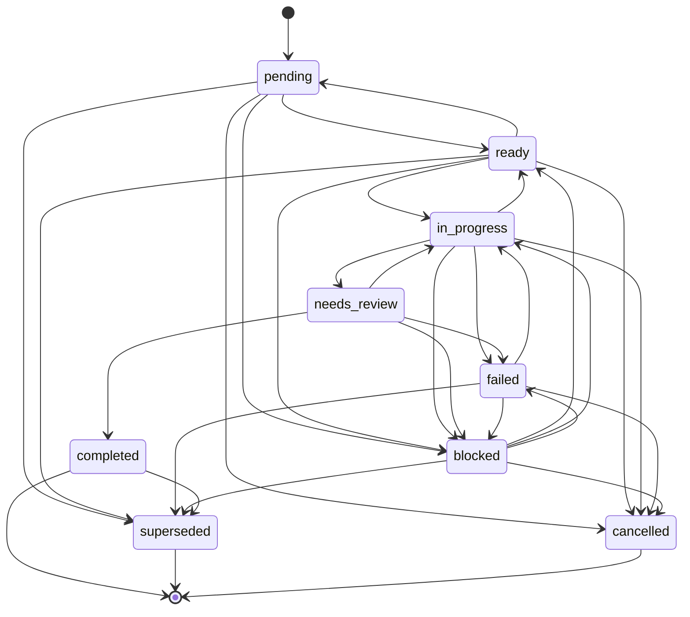
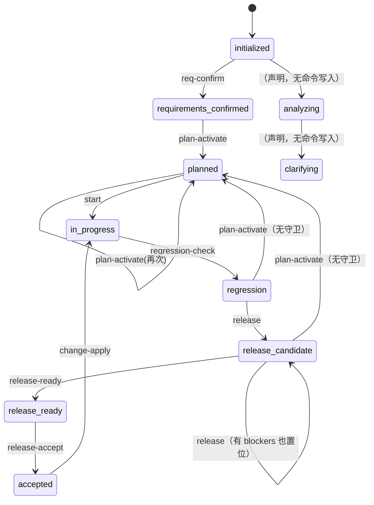
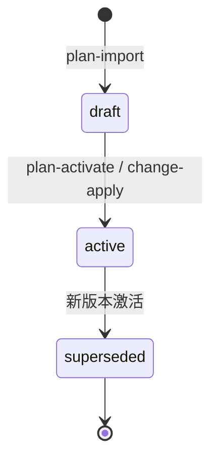
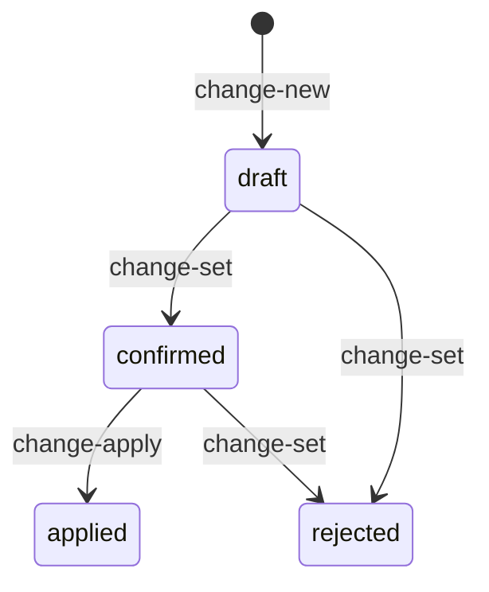

# 03 · 生命周期与状态机

> 状态常量：`dfcore.py:29-75`；迁移函数：`df.py:159 transition()`（节点）；
> 项目状态**没有**统一迁移表，由各命令直接赋值（证据见第五节）。

## 一、端到端生命周期（正常路径）

```mermaid
flowchart LR
  A[init<br/>initialized] --> B[req-import<br/>需求追踪 vN]
  B --> C[req-confirm<br/>requirements_confirmed]
  C --> D[plan-import<br/>draft 计划 + 看板]
  D --> E[plan-activate<br/>planned / active]
  E --> F[start<br/>in_progress + attempt_id]
  F --> G[sync<br/>needs_review / failed]
  G --> H[accept<br/>completed]
  H -->|还有节点| F
  H -->|全部完成| I[regression-check<br/>regression]
  I --> J[regression-import<br/>final-report.json]
  J --> K[release<br/>release_candidate]
  K --> L[release-ready<br/>release_ready]
  L --> M[release-accept --by<br/>accepted]
```



| 阶段 | 前置条件 | 允许命令 | 可改数据 | 必须留下的证据 | 失败恢复 |
| --- | --- | --- | --- | --- | --- |
| init | 目录可写 | `init` | 目录、`project.json` | `project.json` 本身 | 删 `.devflow` 重来；`--force` 幂等（但见 D-04） |
| 需求导入 | `project.json` 存在 | `req-import` | `traceability*.json` | 版本化追踪表 | 重新导入（同版本会覆盖，见 R3） |
| 需求确认 | 追踪表 + 基准文档 | `req-confirm` | `project.json` | 基准 md + 追踪表 | 重新确认 |
| 拆任务 | 需求已确认 | `plan-import`、`prompt-init`、`validate`、`graph` | `backlog-vN.json`、prompt、board、graph | 草稿计划 | 重新导入（`--force` 归档旧文件） |
| 激活 | 草稿 + 校验 0 错误 + 需求文档存在 | `plan-activate` | 计划状态、`project.json` | `approved_by/at` | 无事务；中断可能"无 active 计划"（见 D-06） |
| 执行 | 节点 ready/依赖完成/提示词版本对 | `start` | 节点状态、`attempt_id`、baseline | `attempt_id`、Git baseline | `retry`（归档旧报告） |
| 同步 | 节点 in_progress + 两份报告 | `sync` | 节点状态、`scope_violations`、`git_*` | 两份报告 + 证据块 | `retry` / `fail` |
| 验收 | 节点 needs_review + 证据齐全 + 实时 Git 核对 | `accept` | 节点 completed、`deliverables`、豁免记录 | 交付物指纹、waiver | 保留 `needs_review` 修复后重来 |
| 回归前置 | 无 open 节点、证据齐全、需求覆盖 | `regression-check` | `project.json`（regression）、快照 | `precheck.md`、`source-snapshot.json` | 修节点后重跑 |
| 回归导入 | 报告与计划/需求版本一致 + 快照一致 | `regression-import` | `final-report.{json,md}` | 机器可读报告 | 重新导入（旧报告进 `history/`） |
| 交付报告 | 回归 passed + 节点全完成 + 需求覆盖 | `release` | `release-report.{md,json}`、状态 | 报告 + 元信息 | 重跑 `release`（md 归档） |
| 待验收 | 状态 `release_candidate` + 报告完整 + 快照一致 | `release-ready` | `project.json` | `release_ready_at` | 修复后重跑 |
| 验收 | 状态 `release_ready` | `release-accept` | `project.json`（accepted） | `accepted_by/at` | 终态；继续开发走 CR |

## 二、需求变更流程

```mermaid
flowchart LR
  A[change-new<br/>CR draft] --> B[影响分析<br/>impacts / target_*]
  B --> C[change-set<br/>confirmed]
  C --> D[plan-import vNew<br/>based_on{CR, base}]
  D --> E[prompt-init --plan N]
  E --> F[change-apply<br/>事务提交]
  F --> G[新计划 active<br/>project → in_progress/planned]
  G --> H[执行受影响节点]
  H --> I[regression-check → import]
  I --> J[release → ready → accept]
```

前置条件（`df.py:1623-1700`）：
- CR `status=confirmed`、`target_plan_version` 存在；
- `base_plan_version` / `base_requirement_version` 与当前一致（`base=0` 也参与比较）；
- 目标计划 `status=draft`、`based_on.change_id == CR`、`based_on.plan_version == CR.base_plan_version`；
- 目标计划的需求版本 = CR.target_requirement_version，且需求基准文件存在；
- `migration_problems`（`dfcore.py:1705`）：旧节点不能消失、返工要写 `remark`、新计划不能凭空 completed；
- `validate(activating=True)` 0 错误。

失败恢复：事务 journal 在 `.devflow/.txn/<id>/`，`df.py recover --apply` 回滚（`df.py:2641`）。

## 三、六条状态机（含合法迁移）

### 3.1 Node（唯一有显式迁移表的状态机）



- 表：`dfcore.py:61-71`；`transition()` 拒绝表外迁移（`df.py:159`）。
- 注意：`in_progress → ready` 合法（`retry` 用不到，但允许"重新排队"）。

### 3.2 Project（**无迁移表**）



写入点：`requirements_confirmed`(`df.py:468`)、`planned`(`628`)、`in_progress`(`1080`、`1736`)、
`regression`(`2006`)、`release_candidate`(`2435`)、`release_ready`(`2594`)、`accepted`(`2627`)。

**发现**：
- `analyzing` / `clarifying` 只在常量里出现（`dfcore.py:31-32`），**没有任何命令写入** → 文档声明，代码未证实。
- `plan-activate` 不检查当前状态，可从 `regression`/`release_candidate` 直接回到 `planned`（`df.py:587` 起，仅校验计划自身）。
- `release` 不检查当前状态（只拒 `accepted`，`df.py:2246`），可从 `planned` 跳到 `release_candidate`。
- `release` 在 blockers 非空时**仍然**写入 `release_candidate`（`df.py:2435`，随后 `return 1`）——
  状态语义与"门禁通过"解耦，容易误读。

### 3.3 Plan



- `df.py:619`（激活）、`df.py:616`、`df.py:1729`（supersede）；`validate.py:281` 拒绝多 active。
- **无守卫**：只要 `plan-import` 成功，任何版本号都能激活，`based_on` 不是必填（见 D-01）。

### 3.4 Change Request



- Schema 枚举：`schemas/change.schema.json` `status: draft|confirmed|applied|rejected`。
- `change-apply` 拒绝 `applied` 重复应用、拒绝非 `confirmed`（`df.py:1629-1634`）。
- 无 `rejected` 的专用命令，靠 `change-set` patch；`validate` 不校验 `rejected` 是否写原因。

### 3.5 Regression（报告级）

```
passed  ← 全部必需项 passed
failed  ← 任一必需项 failed
not_run ← 必需项 not_run/skipped
```

- 推导：`df.derive_regression_status`（`df.py:2018`），必需集合来自 `quality-gates.yaml`。
- 报告只能"自洽"，不能自降级（`_regression_data_problems` `df.py:2091`）。
- 项目级状态 `regression` 由 `regression-check` 设置（`df.py:2006`）；报告级结论独立存放。

### 3.6 Release（项目状态的后半段）

见 3.2。额外约束：
- `release-ready` 只接受 `release_candidate`（或 `legacy_release_shortcut` 的 `regression`）（`df.py:2573-2582`）。
- `release-accept` 只接受 `release_ready`，且重新校验全部门槛（`df.py:2602`）。
- `accepted` 后白名单（`df.py:78`）。

## 四、可绕过正常命令改状态的路径（代码证据）

| # | 路径 | 证据 | 严重度 |
| --- | --- | --- | --- |
| B1 | 手工编辑 `backlog-vN.json` 改节点状态，CLI 无哈希可发现 | 无任何完整性校验；`load_json` 直接读（`dfcore.py:107`） | P0（设计前提是"只有 CLI 写"，但无机制保证） |
| B2 | `plan-import` v2 无 `based_on` + `plan-activate` → 绕过 CR 直接换计划 | `df.py:522`（based_on 可空）；`validate.py:516-523`（仅 when based_on）；`df.py:587`（激活无状态/CR 校验） | **P0** |
| B3 | `plan-activate` 从 `regression`/`release_candidate` 回退到 `planned` | `df.py:587-640` 无状态前置；`df.py:628` 直接赋值 | P1 |
| B4 | `release` 从任意状态跳 `release_candidate` | `df.py:2246` 只拒 accepted；`df.py:2435` 无条件置位 | P1（后续 ready 会拦，但状态已污染） |
| B5 | `init --force` 在已有项目上不落盘（不是绕过，但行为与预期不符） | `df.py:287-297` 只改内存对象，未 `save()` | P2 |
| B6 | `doctor` 写依赖图但不在 MUTATING 集合 | `df.py:3338` 调 `_run_dependency_check(...,--write)`；`df.py:47` 不含 doctor | P2（派生文件，可能并发写冲突） |
| B7 | `req-import` 覆盖同版本历史 | `df.py:423` 无 `--force`/归档 | P1 |
| B8 | 手工改 `confirmed-requirements-vN.md`，版本号不变 | `df.py:435-448` 只检查存在/长度/关键词 | **P0** |

## 五、阶段跳转矩阵（实际行为）

| 从 \ 到 | planned | in_progress | regression | release_candidate | release_ready | accepted |
| --- | --- | --- | --- | --- | --- | --- |
| planned | plan-activate | start | regression-check（若无 open 节点） | release（无 guards） | ✗ | ✗ |
| in_progress | plan-activate | — | regression-check | release | ✗ | ✗ |
| regression | plan-activate | start（若节点 ready） | — | release | ✗ | ✗ |
| release_candidate | plan-activate | start | regression-check | release（重生成） | release-ready | ✗ |
| release_ready | plan-activate | ✗ | regression-check | release | — | release-accept |
| accepted | ✗（白名单） | change-apply | ✗ | ✗ | ✗ | — |

> 表中"✓"仅代表**命令不拒绝**，不代表门禁通过；`release-ready` / `release-accept` 会重新校验全部门槛。

## 六、状态机层面的结论

1. 只有 **Node** 有真正的迁移表；Project / Plan 是"命令即状态"，缺少统一收口。
2. 存在 **两条 P0 级状态绕过**：手工改 JSON（B1，设计前提无法强制）与**无 CR 换计划**（B2，可被 CLI 自己放行）。
3. `plan-activate` 是当前最危险的单点：它能改计划、改项目状态、supersede 旧计划，且无事务、无 CR 要求。
4. `release` 的"有 blockers 仍置 candidate"让状态含义模糊，建议拆成 `release_generated` 与 `release_candidate`，
   或规定 blockers 非空时不改状态。
