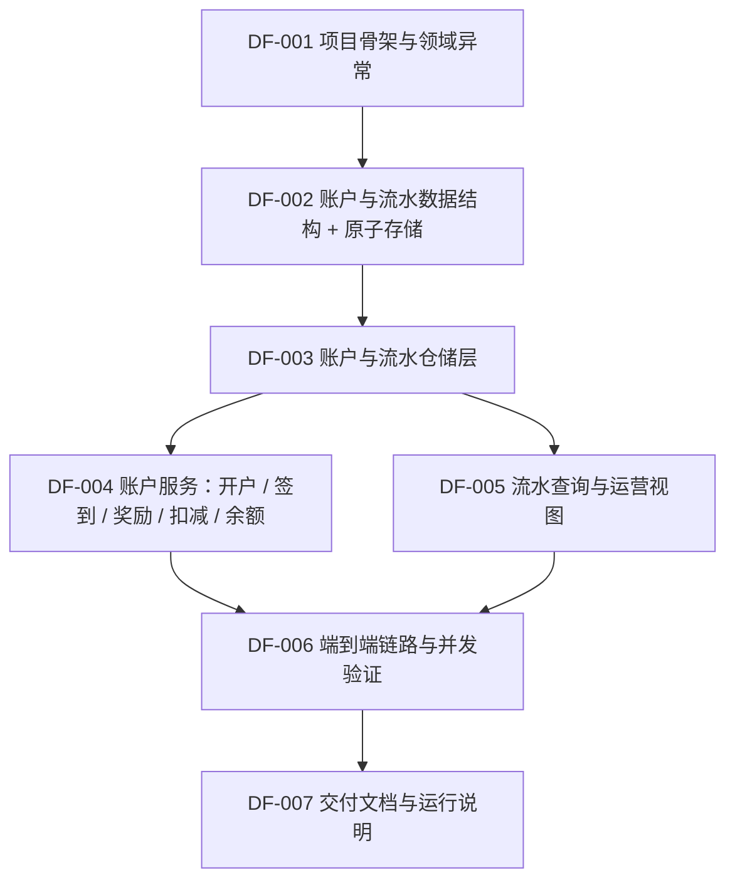

# 依赖图 · 计划 v1

- 节点数：7
- 关键路径：DF-001 → DF-002 → DF-003 → DF-004 → DF-006 → DF-007

## Mermaid

## 分层（同层无依赖，可作并行候选）

- L1：DF-001
- L2：DF-002
- L3：DF-003
- L4：DF-004, DF-005
- L5：DF-006
- L6：DF-007

## 依赖明细

- `DF-001` ← 无（ready）
- `DF-002` ← DF-001（pending）
- `DF-003` ← DF-002（pending）
- `DF-004` ← DF-003（pending）
- `DF-005` ← DF-003（pending）
- `DF-006` ← DF-004, DF-005（pending）
- `DF-007` ← DF-006（pending）
