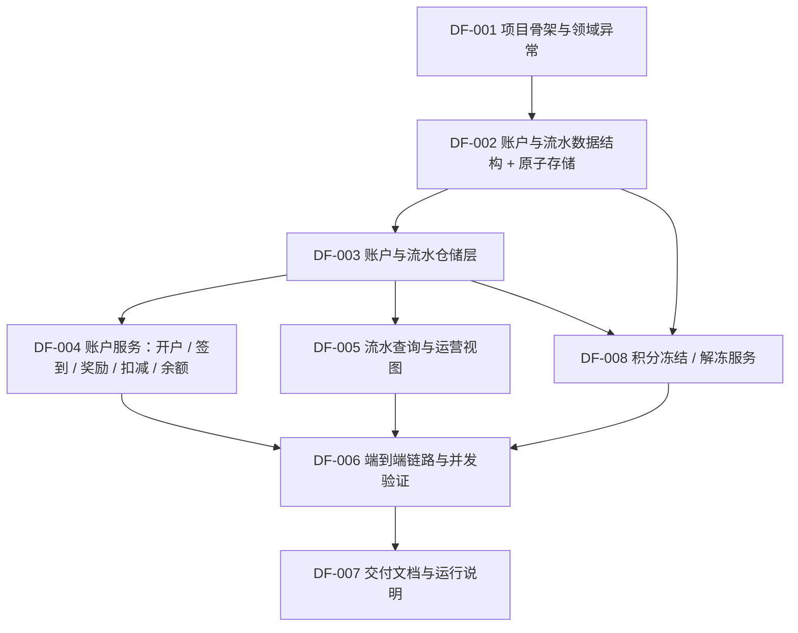

# 依赖图 · 计划 v2

- 节点数：8
- 关键路径：DF-001 → DF-002 → DF-003 → DF-004 → DF-006 → DF-007

## Mermaid

## 分层（同层无依赖，仅作并行候选）

- L1：DF-001
- L2：DF-002
- L3：DF-003
- L4：DF-004, DF-005, DF-008
- L5：DF-006
- L6：DF-007

> 同层只说明「没有依赖」，不说明「改的代码不冲突」。要并行请显式配 `parallel_group`，
> 校验器会检查依赖可达性、`files_scope`、`db_objects`、`api_contracts`、`shared_config`。

## 并行组

- 组 A：DF-004, DF-005

## 依赖明细

- `DF-001` ← 无（completed）
- `DF-002` ← DF-001（completed）
- `DF-003` ← DF-002（completed）
- `DF-004` ← DF-003（completed）
- `DF-005` ← DF-003（completed）
- `DF-006` ← DF-004, DF-005, DF-008（completed）
- `DF-007` ← DF-006（completed）
- `DF-008` ← DF-002, DF-003（completed）
