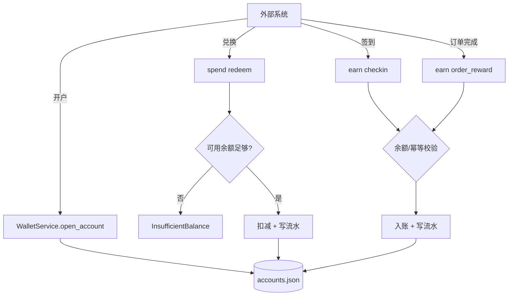

# 需求确认说明书 · v1

> 本文件是 v1 任务规划的唯一需求基准。修改必须走变更流程（CR）。
> 本示例的需求方答复按演示口径设定，见 `clarification.md`。

- 项目：积分账户服务（points-demo）
- 版本：v1
- 确认时间：2026-11-20T17:00:00+08:00
- 确认人：需求方（演示）
- 来源文件：`requirements.md`（v0.9）、`clarification.md`
- 上一版本：无

---

## 1. 项目背景

会员体系需要一套积分能力：用户消费、签到攒积分，积分在积分商城兑换商品。
本期只交付**积分账户与流水**这一层，不含商城页面、不含支付、不含运营后台 UI。

## 2. 建设目标

| 编号 | 目标 | 衡量方式 |
| --- | --- | --- |
| G-001 | 用户能开户、查余额、看流水 | 端到端用例跑通 |
| G-002 | 签到与下单能正确入账，且不重复入账 | 幂等用例通过 |
| G-003 | 兑换扣减不超扣、不出现负余额 | 并发用例通过 |
| G-004 | 运营能按用户/时间查全部流水 | 查询用例通过 |

## 3. 系统边界

- 本系统负责：账户、余额、积分流水、入账/扣减/查询
- 不负责：订单系统、支付、商品、积分商城页面、用户注册（由外部调用开户）
- 边界交互：外部系统通过 `WalletService` 的 Python 接口调用；本期不提供 HTTP

## 4. 用户角色与权限

| 角色 | 能做什么 | 不能做什么 |
| --- | --- | --- |
| 普通用户 | 查自己的余额与流水 | 查别人的 |
| 运营 | 查任意用户的流水 | 直接改余额（只能通过入账/扣减接口，且需留流水） |
| 外部系统 | 调用开户、入账、扣减 | 直接写存储文件 |

## 5. 功能需求

### REQ-001 · 开通积分账户

- 描述：为指定用户开通积分账户，初始余额 0。
- 触发条件：用户注册后由外部系统调用。
- 主流程：校验 user_id 非空 → 若已存在则直接返回已有账户（幂等）→ 否则创建并落盘。
- 异常流程：user_id 为空 → `InvalidArgument`。
- 验收标准：
  - [ ] 同一 user_id 重复开户不报错、不产生第二个账户
  - [ ] 新账户 balance=0、frozen=0
- 关联澄清：Q-101

### REQ-002 · 每日签到送积分

- 描述：每个自然日首次签到时发放 10 积分。
- 主流程：按 `user_id + 日期` 判断是否已签到 → 未签到则入账 10 分并写流水（type=checkin）。
- 异常流程：当天重复签到 → 返回"已签到"，**不重复入账**。
- 验收标准：
  - [ ] 当天首次签到余额 +10
  - [ ] 当天第二次签到余额不变，且不新增流水
- 关联澄清：Q-103

### REQ-003 · 订单完成奖励积分

- 描述：订单完成后按实付金额发放积分，1 元 = 1 积分，向下取整。
- 主流程：金额（分）→ 元 → 向下取整 → 入账，写流水（type=order_reward，带来源单号）。
- 异常流程：金额 ≤ 0 → `InvalidArgument`；同一来源单号重复调用 → 幂等，不重复入账。
- 验收标准：
  - [ ] 1999 分（19.99 元）奖励 19 分
  - [ ] 同一订单号重复调用只入账一次
- 关联澄清：Q-001

### REQ-004 · 兑换扣减积分

- 描述：兑换商品时扣减积分。
- 主流程：校验余额充足 → 扣减 → 写流水（type=redeem，带来源单号）。
- 异常流程：可用余额不足 → `InsufficientBalance`，余额不变、不写流水。
- 验收标准：
  - [ ] 余额不足时抛 `InsufficientBalance`，余额与流水均不变
  - [ ] 扣减到 0 允许；扣减超过余额拒绝
- 关联澄清：Q-003

### REQ-005 · 积分流水

- 描述：每笔变动记录 user_id、类型、数量（正负）、来源单号、时间、备注；支持按用户分页查询。
- 主流程：查询按时间倒序，分页默认 20 条、最大 100 条。
- 验收标准：
  - [ ] 每笔入账/扣减都有且只有一条流水
  - [ ] 分页参数越界时按上限截断而不是报错
- 关联澄清：Q-102

### REQ-006 · 余额查询

- 描述：返回 `balance`（总额）、`frozen`（冻结额，本期恒为 0）、`available`（可用）。
- 验收标准：
  - [ ] available = balance - frozen
  - [ ] 不存在的用户返回 `AccountNotFound`

### REQ-007 · 运营查询全部流水

- 描述：运营可按 user_id / 时间区间查询流水，不受"只能查自己"限制。
- 验收标准：
  - [ ] 不传 user_id 时返回全部用户流水
  - [ ] 传时间区间时按左闭右开过滤

### REQ-008 · 并发安全与数据原子性

- 描述：并发扣减不得超扣；写盘中断不得产生半截文件；积分全程整数运算。
- 验收标准：
  - [ ] 20 线程各扣 1 分、余额 10 分 → 恰好 10 次成功、余额 0
  - [ ] 落盘使用临时文件 + `os.replace`
  - [ ] 代码中不出现 float 参与积分计算

## 6. 核心业务流程

## 7. 业务规则

| 编号 | 规则 | 来源 | 违反时的表现 |
| --- | --- | --- | --- |
| BR-001 | 一个 user_id 只能有一个账户 | REQ-001 | 开户幂等返回已有账户 |
| BR-002 | 1 元 = 1 积分，按实付金额向下取整 | Q-001 | 奖励金额偏差 |
| BR-003 | 余额不允许为负，可用额 = balance - frozen | REQ-004 | `InsufficientBalance` |
| BR-004 | 签到按自然日幂等 | Q-103 | 重复发放 |
| BR-005 | 同一来源单号只能入账一次（幂等） | REQ-003 | 重复发放 |
| BR-006 | 积分一律整数运算 | 需求五 | 精度问题 |

## 8. 非功能需求

| 类别 | 要求 | 验证方式 |
| --- | --- | --- |
| 并发 | 并发扣减不超扣 | 多线程用例 |
| 性能 | 单用户流水查询 1000 条内 < 1s | 手工计时（本期数据量小，不做基准测试） |
| 可用性 | 进程崩溃不产生半截数据 | 原子写实现 + 用例 |
| 安全 | 不记录敏感信息；运营操作留流水 | 代码评审 |
| 兼容性 | Python 3.11+，仅标准库 | 无第三方依赖检查 |

## 9. 数据需求

| 实体 | 关键字段 | 约束 | 保留策略 |
| --- | --- | --- | --- |
| Account | user_id, balance, frozen, version, created_at | user_id 唯一 | 长期 |
| LedgerEntry | entry_id, user_id, type, amount, source_id, created_at, note | amount 非 0；同一 source_id 同 type 唯一 | 长期 |

- 数据归属：本服务
- 数据迁移：本期无历史数据；`frozen` 字段本期恒 0
- 数据一致性：账户余额与流水累计值必须一致（由同一把锁保证）

## 10. 外部依赖

| 依赖 | 用途 | 不可用时的降级 |
| --- | --- | --- |
| 无 | — | — |

## 11. 技术约束

- 必须使用：Python 3.11+ 标准库
- 禁止引入：任何第三方运行时依赖（含 ORM、web 框架）
- 必须遵循：`src/points/` 布局、领域异常统一在 `errors.py`

## 12. 异常与边界条件

| 场景 | 期望行为 |
| --- | --- |
| user_id 为空 | `InvalidArgument` |
| 账户不存在 | `AccountNotFound` |
| 余额不足 | `InsufficientBalance`，无副作用 |
| 金额为 0 或负数 | `InvalidArgument` |
| 分页 size > 100 | 截断为 100 |
| 并发扣减 | 串行化，不超扣 |

## 13. 验收标准（整体）

- [ ] REQ-001 ~ REQ-007 的验收标准全部满足
- [ ] REQ-008 的并发用例通过
- [ ] 全量测试 `python -m unittest discover -s tests -v` 全绿

## 14. 已确认决策

| 决策 | 结论 | 依据 |
| --- | --- | --- |
| 下单奖励比例 | 1 元 = 1 分，向下取整 | Q-001 |
| 有效期 | 本期不做，字段预留 | Q-002 |
| 并发方案 | 进程内可重入锁，接口预留 version | Q-003 |
| 退款回收 | 本期不做 | Q-004 |
| 存储 | JSON 文件 + 原子写 | Q-201 |

## 15. 未解决问题与风险

| 编号 | 问题 | 影响 | 处理方式 |
| --- | --- | --- | --- |
| OPEN-001 | 退款回收/冻结积分 | 账户模型需加冻结额度 | 后续变更（CR-001） |
| OPEN-002 | 积分过期 | 需定时任务 | 本期不做 |
| OPEN-003 | 运营鉴权 | 本期仅参数区分 | 接口层后续补 |
