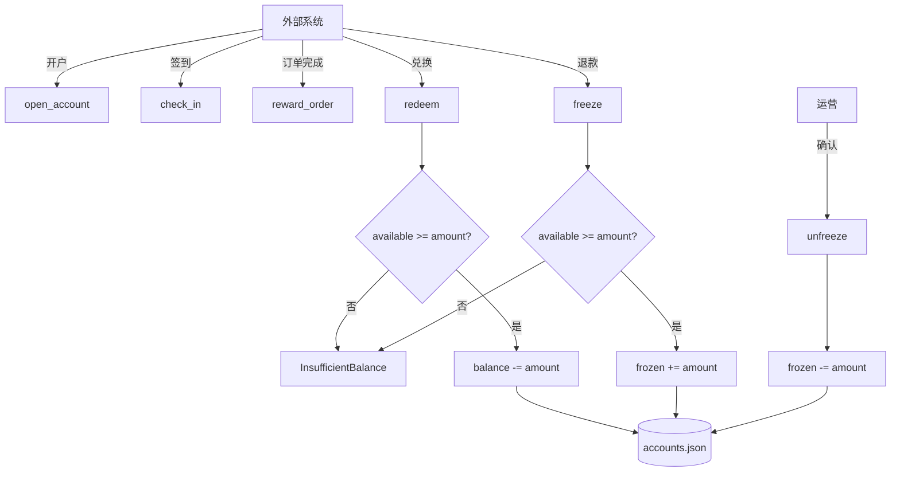

# 需求确认说明书 · v2

> 本文件是 v2 任务规划的唯一需求基准。相比 v1 的差异见文末「版本变更」。
> 修改必须继续走变更流程（CR）。

- 项目：积分账户服务（points-demo）
- 版本：v2
- 确认时间：2026-11-25T14:06:00+08:00
- 确认人：需求方（演示）
- 来源文件：`requirements.md`（v0.9）、`clarification.md`、`CR-001`
- 上一版本：v1

---

## 1. 项目背景

会员体系需要一套积分能力：用户消费、签到攒积分，积分在积分商城兑换商品。
本期交付**积分账户与流水**，含退款场景下的积分冻结/解冻。不含商城页面、支付、运营后台 UI。

## 2. 建设目标

| 编号 | 目标 | 衡量方式 |
| --- | --- | --- |
| G-001 | 用户能开户、查余额、看流水 | 端到端用例跑通 |
| G-002 | 签到与下单正确入账且不重复入账 | 幂等用例通过 |
| G-003 | 兑换扣减不超扣、不出现负余额 | 并发用例通过 |
| G-004 | 运营能按用户/时间查全部流水 | 查询用例通过 |
| G-005 | 退款时能冻结等额积分，冻结部分不可用 | 冻结链路用例通过 |

## 3. 系统边界

- 本系统负责：账户、余额、冻结额度、积分流水、入账/扣减/冻结/解冻/查询
- 不负责：订单系统、支付、退款单据本身、商城页面、用户注册
- 边界交互：外部系统调用 `WalletService` / `FreezeService` 的 Python 接口；本期不提供 HTTP

## 4. 用户角色与权限

| 角色 | 能做什么 | 不能做什么 |
| --- | --- | --- |
| 普通用户 | 查自己的余额与流水 | 查别人的、自己解冻 |
| 运营 | 查任意用户流水、执行冻结/解冻 | 直接改余额 |
| 外部系统（退款） | 调用冻结、解冻 | 直接写存储文件 |

## 5. 功能需求

### REQ-001 · 开通积分账户

- 描述：为指定 user_id 开通账户，初始 balance=0、frozen=0。
- 主流程：校验 user_id → 已存在则返回已有账户（幂等）→ 否则创建并落盘。
- 异常：user_id 为空 → `InvalidArgument`。
- 验收标准：
  - [ ] 重复开户不产生第二个账户
  - [ ] 新账户 balance=0、frozen=0

### REQ-002 · 每日签到送积分

- 描述：每个自然日首次签到发放 10 积分。
- 异常：当天重复签到 → 返回 `already_checked_in`，不入账、不写流水。
- 验收标准：
  - [ ] 当天首次签到余额 +10
  - [ ] 当天第二次签到余额不变、流水不增

### REQ-003 · 订单完成奖励积分

- 描述：1 元 = 1 积分，按实付金额（分）整除 100 向下取整；同一订单号幂等。
- 验收标准：
  - [ ] 1999 分 → 19 分
  - [ ] 同一订单号重复调用只入账一次
  - [ ] 金额不足 1 元（<100 分）不入账

### REQ-004 · 兑换扣减积分

- 描述：兑换商品时扣减积分，**按可用积分（balance - frozen）校验**。
- 异常：可用积分不足 → `InsufficientBalance`，余额、冻结额、流水均不变。
- 验收标准：
  - [ ] 可用不足时无副作用
  - [ ] 允许扣到 0，不允许扣成负数
  - [ ] 冻结后可用额度下降，兑换按新额度校验

### REQ-005 · 积分流水

- 描述：每笔变动记录类型、amount（余额变动，带符号）、frozen_delta（冻结变动，带符号）、来源单号、时间。
- 类型：`checkin` / `order_reward` / `redeem` / `freeze` / `unfreeze`
- 验收标准：
  - [ ] 每笔变动有且只有一条流水
  - [ ] 分页默认 20、最大 100
  - [ ] `sum(amount) == balance` 且 `sum(frozen_delta) == frozen`

### REQ-006 · 余额查询

- 描述：返回 `balance` / `frozen` / `available`，`available = balance - frozen`。
- 验收标准：
  - [ ] 三值关系正确
  - [ ] 不存在的用户抛 `AccountNotFound`

### REQ-007 · 运营查询全部流水

- 描述：运营可按 user_id / 时间区间查询全部流水。
- 验收标准：
  - [ ] 不传 user_id 返回全部
  - [ ] 时间区间左闭右开

### REQ-008 · 并发安全与数据原子性

- 描述：并发扣减/冻结不得超扣、不得超冻；写盘原子；积分全程整数运算。
- 验收标准：
  - [ ] 20 线程各扣 1 分、可用 10 分 → 恰好 10 次成功
  - [ ] 20 线程各冻结 1 分、可用 10 分 → 恰好 10 次成功，frozen 不超过 balance
  - [ ] 落盘使用临时文件 + `os.replace`
  - [ ] 积分计算不出现 float

### REQ-009 · 积分冻结与解冻（v2 新增）

- 描述：退款时冻结等额积分；运营可解冻。
- 主流程：
  - 冻结：校验 `available >= amount` → `frozen += amount` → 写 `freeze` 流水（`amount=0`，`frozen_delta=+amount`）。
  - 解冻：校验 `frozen >= amount` → `frozen -= amount` → 写 `unfreeze` 流水（`amount=0`，`frozen_delta=-amount`）。
- 异常：
  - `amount <= 0` → `InvalidArgument`
  - 冻结时可用不足 → `InsufficientBalance`
  - 解冻时冻结额不足 → `InvalidArgument`（不允许解冻超过已冻结）
  - 同一 `source_id` 重复冻结/解冻 → `DuplicateRequest`
- 验收标准：
  - [ ] 冻结后 balance 不变、available 减少、frozen 增加
  - [ ] 冻结后兑换按新 available 校验
  - [ ] 允许部分解冻；解冻后 available 恢复
  - [ ] 冻结/解冻各产生一条流水，且 `sum(frozen_delta) == frozen`
- 来源：CR-001 / Q-004

## 6. 核心业务流程

## 7. 业务规则

| 编号 | 规则 | 来源 | 违反时的表现 |
| --- | --- | --- | --- |
| BR-001 | 一个 user_id 只能有一个账户 | REQ-001 | 开户幂等 |
| BR-002 | 1 元 = 1 积分，向下取整 | Q-001 | 金额偏差 |
| BR-003 | 余额不允许为负，可用额 = balance - frozen | REQ-004 | `InsufficientBalance` |
| BR-004 | 签到按自然日幂等 | Q-103 | 重复发放 |
| BR-005 | 同一来源单号只能入账一次 | REQ-003 | 重复发放 |
| BR-006 | 积分一律整数运算 | 需求五 | 精度问题 |
| BR-007 | 冻结不改变 balance，只改变 frozen | REQ-009 | 对账不平 |
| BR-008 | 冻结与解冻必须留流水（frozen_delta） | REQ-009 | 无法审计 |

## 8. 非功能需求

| 类别 | 要求 | 验证方式 |
| --- | --- | --- |
| 并发 | 扣减不超扣、冻结不超冻 | 多线程用例 |
| 性能 | 单用户流水查询 1000 条内 < 1s | 手工计时 |
| 可用性 | 进程崩溃不产生半截数据 | 原子写 + 用例 |
| 安全 | 不记录敏感信息；冻结/解冻留流水 | 代码评审 |
| 兼容性 | Python 3.11+，仅标准库 | 无第三方依赖检查 |

## 9. 数据需求

| 实体 | 关键字段 | 约束 | 保留策略 |
| --- | --- | --- | --- |
| Account | user_id, balance, frozen, version, created_at | user_id 唯一；0 <= frozen <= balance | 长期 |
| LedgerEntry | entry_id, user_id, type, amount, frozen_delta, source_id, created_at, note | amount 与 frozen_delta 不能同时为 0 | 长期 |

- 数据迁移：v1 流水没有 `frozen_delta`，读取时默认 0，无需重写
- 数据一致性：`sum(amount) == balance`、`sum(frozen_delta) == frozen`

## 10. 外部依赖

| 依赖 | 用途 | 不可用时的降级 |
| --- | --- | --- |
| 无 | — | — |

## 11. 技术约束

- 必须使用：Python 3.11+ 标准库
- 禁止引入：任何第三方运行时依赖
- 必须遵循：`src/points/` 布局、领域异常统一在 `errors.py`、所有写操作一次落盘

## 12. 异常与边界条件

| 场景 | 期望行为 |
| --- | --- |
| user_id 为空 | `InvalidArgument` |
| 账户不存在 | `AccountNotFound` |
| 可用积分不足 | `InsufficientBalance`，无副作用 |
| 冻结额不足时解冻 | `InvalidArgument` |
| 重复冻结单号 | `DuplicateRequest` |
| 金额为 0 或负数 | `InvalidArgument` |
| 分页 size > 100 | 截断为 100 |
| 并发扣减/冻结 | 串行化，不超扣不超冻 |

## 13. 验收标准（整体）

- [ ] REQ-001 ~ REQ-009 的验收标准全部满足
- [ ] 全量测试 `python -m unittest discover -s tests -v` 全绿
- [ ] 两条对账断言成立

## 14. 已确认决策

| 决策 | 结论 | 依据 |
| --- | --- | --- |
| 下单奖励比例 | 1 元 = 1 分，向下取整 | Q-001 |
| 有效期 | 本期不做 | Q-002 |
| 并发方案 | 进程内锁，接口预留 version | Q-003 |
| 退款处理 | v2 起冻结，不直接扣减 | CR-001 |
| 冻结粒度 | 按金额，允许部分解冻 | CR-001 |
| 冻结过期 | 本期不做 | CR-001 |

## 15. 未解决问题与风险

| 编号 | 问题 | 影响 | 处理方式 |
| --- | --- | --- | --- |
| OPEN-002 | 积分过期 | 需定时任务 | 本期不做 |
| OPEN-003 | 运营鉴权 | 本期仅参数区分 | 后续补 |
| OPEN-004 | 冻结长期不处理 | 用户积分永久不可用 | 运营流程约定，本期不做自动过期 |

---

## 版本变更（v1 → v2）

| 项 | v1 | v2 |
| --- | --- | --- |
| REQ-004 | 按余额校验 | 按**可用积分**校验 |
| REQ-005 | 流水只有 amount | 增加 `frozen_delta`，新增两种类型 |
| REQ-006 | frozen 恒 0 | frozen 可为非 0 |
| REQ-009 | 无 | 新增冻结/解冻 |
| BR-007/008 | 无 | 新增 |
| OPEN-001 | 未解决 | 已由 CR-001 解决 |
