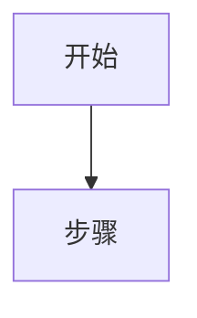

# 需求确认说明书 · v{{version}}

> 本文件是**当前版本任务规划的唯一需求基准**。任务拆解、验收、变更评估都以它为准。
> 修改它必须走变更流程（CR），不能直接改。

- 项目：{{project_name}}
- 版本：v{{version}}
- 确认时间：{{confirmed_at}}
- 确认人：{{confirmed_by}}
- 来源文件：{{source_files}}
- 上一版本：{{previous_version}}

---

## 1. 项目背景

（为什么做、解决什么问题、不做什么）

## 2. 建设目标

| 编号 | 目标 | 衡量方式 |
| --- | --- | --- |
| G-001 |  |  |

## 3. 系统边界

- 本系统负责：
- 不负责（由外部系统/人工承担）：
- 边界上的交互方式：

## 4. 用户角色与权限

| 角色 | 能做什么 | 不能做什么 |
| --- | --- | --- |

## 5. 功能需求

### REQ-001 · {{title}}

- 描述：
- 触发条件：
- 主流程：
- 异常流程：
- 验收标准：
  - [ ]
- 关联澄清：Q-xxx

（按此结构逐条列出。编号一旦分配不再复用。）

## 6. 核心业务流程

## 7. 业务规则

| 编号 | 规则 | 来源 | 违反时的表现 |
| --- | --- | --- | --- |
| BR-001 |  | Q-xxx |  |

## 8. 非功能需求

| 类别 | 要求 | 验证方式 |
| --- | --- | --- |
| 性能 |  |  |
| 并发 |  |  |
| 可用性 |  |  |
| 安全 |  |  |
| 兼容性 |  |  |

## 9. 数据需求

| 实体 | 关键字段 | 约束 | 保留策略 |
| --- | --- | --- | --- |

- 数据归属：
- 数据迁移：
- 数据一致性要求：

## 10. 外部依赖

| 依赖 | 用途 | 不可用时的降级 |
| --- | --- | --- |

## 11. 技术约束

- 必须使用：
- 禁止引入：
- 必须遵循的现有规范：

## 12. 异常与边界条件

| 场景 | 期望行为 |
| --- | --- |

## 13. 验收标准（整体）

- [ ]
- [ ]

## 14. 已确认决策

| 决策 | 结论 | 依据 |
| --- | --- | --- |

## 15. 未解决问题与风险

| 编号 | 问题 | 影响 | 处理方式 |
| --- | --- | --- | --- |
